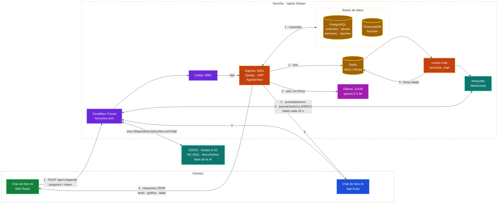

# Nico AI

Agente de cada dispositivo que responde en lenguaje natural sobre sus lecturas, alertas,
sensores, umbrales y reportes. Es de solo lectura y las cifras siempre salen del backend; la IA
solo interpreta y redacta.

## Recorrido de una pregunta

1. La web o la app envía la pregunta al backend, que consulta las cifras.
2. Si hace falta la IA, el backend manda un reto al ESP32 de **Núcleo A-01 (NC-0501)** por MQTT.
3. El ESP lo firma con su clave (HMAC-SHA256) y solo con esa firma el backend usa Ollama
   (`qwen2.5:1.5b`, en el mismo servidor).
4. El backend responde al chat.

El ESP manda un latido cada 20 s: sin latido en 75 s, o con su último mensaje al desconectarse,
Nico se desactiva. Solo A-01 usa la IA; los demás dispositivos son simulados y responden sin
ella. Si la firma no llega en 12 s o la IA tarda más de 20 s, el agente contesta solo con las
reglas.

Para validar cambios: `manage.py evaluar_agente --dispositivo NC-0501` corre el banco de casos
(`apps/reportes/casos_agente.py`) sin guardar nada. El detalle está en
[`backend/estructura-backend.md`](../backend/estructura-backend.md#agente-ia).

## Consola de Nico AI (nicoai.bynucleo.com)

Página solo web para el superusuario (rol administrador de plataforma), para atender al agente sin
cambiar código. Es la misma web compilada: `main.jsx` abre `src/consola/` cuando el host empieza con
`nicoai.` (en desarrollo, `http://nicoai.localhost:5173`). La API vive en `apps/nico`
(`/api/v1/nico/…`).

- **Chat**: el mismo Nico eligiendo empresa, área y dispositivo; responde como administrador de esa
  empresa (copia en memoria del superusuario, nunca se guarda) y el registro queda a su nombre.
- **Banco de respuestas**: respuestas *fijas* (tema `FIJA`: se devuelven tal cual y ganan a la charla
  y a las reglas), *rutas* (`RUTA`: responder como si hubieran hecho otra pregunta) y las aprendidas
  de los 👍. Se pueden crear para una empresa o para todas, editar, apagar y borrar.
- **Registro de preguntas**: lo que preguntan los usuarios, con filtros por empresa, vía y voto;
  «Enseñar» crea la respuesta correcta en el banco.
- **Herramientas y propósitos**: se editan la descripción, el propósito y el ejemplo de cada
  herramienta (modelo `AjusteHerramienta`; «Restaurar» vuelve al texto del código) y se pueden
  apagar: Nico contesta que esa consulta está desactivada.
- **Documentos**: SOUL, IDENTITY, AGENTS, USER, TOOLS, MEMORY y los que se agreguen (modelo
  `DocumentoNico`). Los activos se suman a las instrucciones de la IA local, hasta 2 400 caracteres
  entre todos; con documentos el contexto de Ollama sube de 1024 a 2048 (igual en todas las
  llamadas para no recargar el modelo). Las cifras siempre salen de las herramientas.

Los ajustes se guardan en caché 5 minutos y se limpian al editar.

## Relacionado

- [Herramientas de Nico AI](../backend/herramientas-agente.md): catálogo, acciones en dos pasos,
  personalidad, protección del servidor y pruebas.
- [Firmware y hardware](../iot/firmware-y-hardware.md#llave-de-nico-ai): la llave en el ESP32 y el
  modo puente.
- [Servidor de producción](../servidor/produccion.md) y la sección de Ollama en
  [`deploy/README.md`](../../deploy/README.md).
