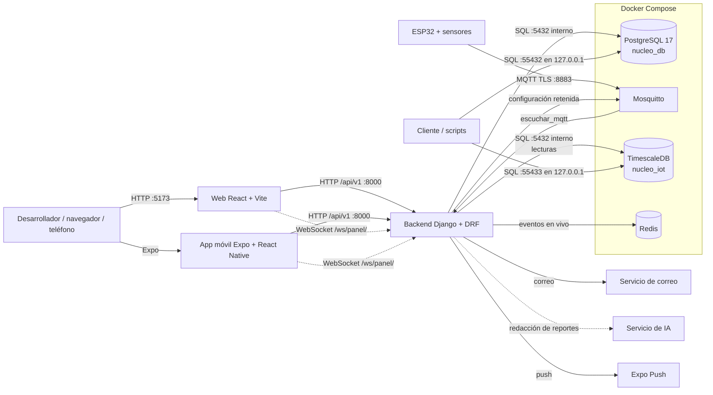

# Arquitectura general de Núcleo

## Propósito

Núcleo gestiona y monitorea el ambiente mediante nodos ESP32 que miden
temperatura, humedad relativa y calidad del aire. Los nodos publican por MQTT;
el backend guarda las lecturas, las compara con los umbrales, genera alertas y
reportes, y expone una API REST que consumen la web y la app móvil.

## Componentes

- **`BackEnd/`**
  - API Django REST con autenticación por token y permisos por rol.
  - Modelo relacional de 16 tablas en PostgreSQL con aislamiento por organización, y
    lecturas en una hypertable de TimescaleDB.
  - Consumidor MQTT que valida y guarda lecturas y genera alertas de advertencia y peligro.
  - Canal en vivo (WebSocket `ws/panel/`, Django Channels y Redis) y notificaciones push con Expo.
  - Reportes con cifras calculadas en el backend, texto de IA, PDF y programaciones.
- **`FrontEnd/`**
  - Web React con la pantalla de salud del backend y un esqueleto de módulos enlazados
    por rutas y menú (`acceso`, `panel`, `dispositivos`, `mediciones`, `alertas`,
    `reportes`, `usuarios`, `organizaciones`) que muestran una pantalla provisional.
- **`Mobile/`**
  - App Expo/React Native con la pantalla de salud del backend y un esqueleto de módulos
    enlazados por navegación (`acceso`, `panel`, `dispositivos`, `mediciones`, `alertas`).
- **`IoT/`**
  - Firmware base MicroPython 1.29.0 para el ESP32 con DHT22, CCS811, OLED, LED RGB,
    buzzer y MQTT sobre TLS; cola de lecturas sin conexión y baseline del CCS811.
- **`Mosquitto/`**
  - Configuración del broker, ACL por usuario, `preparar.sh` (certificados y usuarios de
    desarrollo) y `dispositivo.sh` (alta de un usuario por dispositivo).
- **`Database/`**
  - Scripts SQL de práctica: `Web-Mobile/` (16 tablas, en `nucleo_test`) e `IoT/`
    (hypertable `lectura`, en `nucleo_iot_test`), y `crear-roles.sh` para usuarios de base
    de datos sin superusuario.
- **`Context/`**
  - Arquitectura, instalación, estructura y decisiones.
- **`Docs/`**
  - SRS, modelo relacional y documentos de planificación y análisis.
- **Docker Compose**
  - PostgreSQL 17 para Django, TimescaleDB para IoT, Redis para el canal en vivo y Mosquitto.

## Vista de despliegue local



La web y la app móvil son dos clientes del mismo backend. Django utiliza
`nucleo_db` para los datos de negocio y `nucleo_iot` (TimescaleDB) para las lecturas,
separada de la base transaccional y sin llaves foráneas entre ambas; `nucleo_test` y
`nucleo_iot_test` son solo espacios locales de práctica.

## Flujos

1. **Lectura:** el nodo publica un JSON en `nucleo/devices/<codigo_mqtt>/measurements`.
   `escuchar_mqtt` lo valida, guarda cada lectura en TimescaleDB con su hora de
   medición y de recepción, y actualiza el dispositivo.
2. **Alerta:** cada lectura estabilizada se clasifica con el umbral activo de su
   dispositivo y variable. Si sale de los límites de advertencia o de peligro se crea, en
   una transacción de `nucleo_db`, la alerta (con una copia de la lectura) y una
   notificación por responsable; el correo sale al supervisor del área.
3. **Consulta:** web y móvil piden lecturas, tendencias, alertas y reportes a la
   API REST con su token; cada respuesta se limita a la organización y al alcance
   del rol.
4. **Atención:** un administrador o supervisor atiende o descarta la alerta; queda
   registrado quién y cuándo.
5. **Configuración:** al cambiar el intervalo o los umbrales de un dispositivo, el
   backend puede publicar su configuración retenida para que el nodo la use
   también sin conexión.
6. **En vivo:** cada alerta nueva o resuelta y cada cambio de estado de un dispositivo se
   publica en Redis al confirmarse la transacción; el consumidor WebSocket lo reenvía
   a las conexiones de la organización según el rol (operador: su dispositivo;
   supervisor y analista: su área). Si Redis falla, las alertas y lecturas siguen su curso.
7. **Sin conexión:** `marcar_sin_conexion` cambia el estado de los dispositivos
   que dejan de enviar lecturas.
8. **Reportes:** el backend calcula las cifras de un periodo (solo lecturas
   estabilizadas), la IA redacta el texto y se genera el PDF; las programaciones
   diarias, semanales o mensuales los envían por correo.

## Comunicación entre componentes

```text
Origen → Destino                                Protocolo                  Estado
├── Web → Backend                               HTTP/JSON con token        API lista; la web solo consulta salud
├── Mobile → Backend                            HTTP/JSON con token        API lista; la app solo consulta salud
├── Web / Mobile → Backend                      WebSocket /ws/panel/       Activo en el backend; sin cliente todavía
├── Backend → Redis                             Capa de canales            Activo
├── Backend → Expo Push                         HTTPS                      Implementado; apagado por defecto
├── Backend → PostgreSQL nucleo_db              SQL/psycopg 3              Activo; 16 tablas
├── ESP32 → Mosquitto                           MQTT sobre TLS :8883       Firmware base escrito; sin probar en hardware
├── Mosquitto → Backend                         MQTT (escuchar_mqtt)       Activo
├── Backend → Mosquitto                         MQTT retenido (config)     Activo con MQTT_PUBLICAR_CONFIG
├── Backend → correo                            SMTP                       Activo; consola en desarrollo
├── Backend → servicio de IA                    HTTPS                      Proveedor por definir
├── Backend → TimescaleDB nucleo_iot            SQL/psycopg 3              Activo; hypertable lectura
└── Herramientas locales → PostgreSQL/Timescale SQL :55432 y :55433        Activo; solo loopback
```

## Límites y decisiones abiertas

- Notificaciones push con Expo: el envío está implementado y apagado
  (`NUCLEO_PUSH_HABILITADO`); falta probarlo con un teléfono real.
- Proveedores del servicio de IA y del correo.
- Clientes web y móvil del canal en vivo (el backend ya lo ofrece).
- Despliegue del broker y de los certificados fuera de desarrollo.
- Estrategia de retención, respaldo y recuperación.
- Aplicar los usuarios de base de datos sin superusuario (`Database/crear-roles.sh`) en el
  despliegue; en Docker de desarrollo siguen siendo superusuarios dentro de su contenedor.
- Validación del modelo exacto de ESP32, pinout y circuito de alimentación.

Las decisiones tomadas se registran en
`Context/decisiones-tecnicas/stack-tecnologico.md`.
