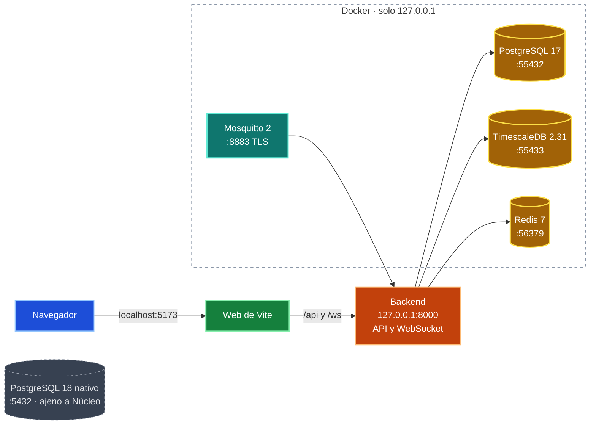

# Guía de desarrollo local

## Requisitos comprobados

- **Python:** 3.12.15 (además existe 3.14; backend e IoT usan 3.12).
- **Node.js / npm:** 24.18.0 / 11.16.0.
- **Docker Engine / Compose:** 29.9.2 / 5.6.1.
- **Git:** 2.56.0.
- **esptool / mpremote:** 5.6.0 / 1.29.0, en `IoT/.venv`.
- **VS Code + Pymakr:** Pymakr 2.22.5.
- **PostgreSQL:** 17.11 (imagen `postgres:17-alpine`).
- **TimescaleDB:** 2.31.0 (imagen `timescale/timescaledb:2.31.0-pg17`).
- **Expo / React Native:** 58.0.23 / 0.88.1, en `Mobile/`.

No se requiere PostgreSQL nativo. El usuario del sistema debe pertenecer al
grupo `docker` o tener acceso equivalente al daemon.

## 1. Variables de entorno

Crea los cuatro archivos locales (están ignorados por Git):

```bash
cp .env.example .env
cp BackEnd/.env.example BackEnd/.env
cp FrontEnd/.env.example FrontEnd/.env
cp Mobile/.env.example Mobile/.env
```

Genera valores únicos:

```bash
openssl rand -hex 24
python3.12 -c "import secrets; print(secrets.token_urlsafe(64))"
```

- `.env`: `POSTGRES_PASSWORD` para la base de Django, `IOT_PASSWORD` para
  TimescaleDB y `REDIS_PASSWORD` para Redis.
- `BackEnd/.env`: usa `POSTGRES_PASSWORD` dentro de `DATABASE_URL`, `IOT_PASSWORD`
  dentro de `IOT_DATABASE_URL`, `REDIS_PASSWORD` dentro de `REDIS_URL` y una clave
  secreta de Django.
- `FrontEnd/.env`: `VITE_API_BASE_URL=http://localhost:8000/api/v1`.
- `Mobile/.env`: `EXPO_PUBLIC_API_BASE_URL`; usa `10.0.2.2` en el emulador
  Android, `localhost` en el simulador iOS o la IP local en un teléfono.

- `.env`: `MQTT_BACKEND_PASSWORD` y `MQTT_DEVICE_PASSWORD` son las contraseñas del broker; la
  primera va también como `MQTT_PASSWORD` en `BackEnd/.env`.

No subas `.env`, `secrets.py` ni certificados privados a Git.

Protege los archivos:

```bash
chmod 600 .env BackEnd/.env FrontEnd/.env Mobile/.env
```

## 2. Orden de inicio

Desde la raíz del proyecto:

```bash
docker compose up -d --wait
python3.12 -m venv BackEnd/.venv
BackEnd/.venv/bin/pip install --upgrade pip
BackEnd/.venv/bin/pip install -r BackEnd/requirements-dev.txt
(cd BackEnd && .venv/bin/python manage.py migrate)
(cd BackEnd && .venv/bin/python manage.py migrate --database=iot)
(cd BackEnd && .venv/bin/python manage.py sembrar_demo)
(cd BackEnd && .venv/bin/python manage.py runserver 0.0.0.0:8000)
```

`runserver` atiende la API y el canal en vivo (`ws://127.0.0.1:8000/ws/panel/?token=…`,
Daphne está instalado primero); Redis (`docker compose up -d --wait`) debe estar encendido
para que el canal funcione entre el consumidor MQTT y el servidor web.

`migrate` crea las 16 tablas del modelo relacional en `nucleo_db` y carga los
catálogos; `migrate --database=iot` crea la hypertable `lectura` en `nucleo_iot` (requiere
`IOT_DATABASE_URL` en `BackEnd/.env`). `sembrar_demo` crea Grupo Altamira (4 áreas, 14
usuarios de todos los roles, 15 dispositivos, entre ellos `NUC-001`) y Clínica San Rafael,
14 días de lecturas, alertas, notificaciones, reportes y programaciones. Todas las cuentas
usan la contraseña `Nucleo2026`; `--reiniciar` borra los datos y siembra de nuevo.

Para ver lecturas nuevas sin el ESP32, deja en otra terminal:

```bash
(cd BackEnd && .venv/bin/python manage.py simular_dispositivos)
```

Cada dispositivo en servicio (menos `NUC-001`, que es el real) manda un mensaje a su
intervalo con el mismo formato que el firmware; las lecturas, alertas y eventos en vivo
siguen el mismo camino que las de MQTT. Con `--mqtt` el mensaje se publica en el broker
y lo recibe `escuchar_mqtt`.

Para recibir lecturas del dispositivo hace falta el broker. Define
`MQTT_BACKEND_PASSWORD` y `MQTT_DEVICE_PASSWORD` en el `.env` raíz (la segunda es la
contraseña del usuario `NUC-001`) y ejecuta:

```bash
bash Mosquitto/preparar.sh
docker compose up -d --wait mosquitto
(cd BackEnd && .venv/bin/python manage.py escuchar_mqtt)
```

Para otro dispositivo: `bash Mosquitto/dispositivo.sh NUC-002`. El consumidor se deja en
su propia terminal. Los pasos completos del broker están
en `Context/mqtt/broker-mosquitto.md`.

En otra terminal, también desde la raíz:

```bash
(cd FrontEnd && npm ci)
(cd FrontEnd && npm run dev)
```

La app móvil se inicia aparte:

```bash
(cd Mobile && npm ci)
(cd Mobile && npm start)
```

Las notificaciones push solo llegan en el APK compilado (`deploy/compilar_apk.sh`), con
`Mobile/google-services.json` (fuera de git); en Expo Go o en el emulador se prueban con la
app abierta por el canal en vivo.

El nodo IoT (MicroPython) es independiente:

```bash
python3.12 -m venv IoT/.venv
IoT/.venv/bin/pip install --upgrade pip
IoT/.venv/bin/pip install -r IoT/requirements.txt
code --install-extension pycom.pymakr
IoT/.venv/bin/esptool --port /dev/ttyUSB0 erase-flash
IoT/.venv/bin/esptool --port /dev/ttyUSB0 --baud 460800 write-flash 0x1000 \
  IoT/micropython/firmware/ESP32_GENERIC-20260824-v1.29.0.bin
```

Luego, desde `IoT/micropython/`, se prepara y se sube el código (detalle en
`IoT/README.md`):

```bash
cp secrets.example.py secrets.py     # completar Wi-Fi, CODIGO_MQTT, broker y contraseña del dispositivo
mkdir -p certs
openssl x509 -in ../../Mosquitto/certs/ca.crt -outform DER -out certs/ca.der
../.venv/bin/mpremote connect /dev/ttyUSB0 fs cp -r lib certs nucleo config.py secrets.py boot.py main.py :
```

El grabado del firmware se hace una sola vez por placa. Después se trabaja con
Pymakr abriendo `IoT/micropython/` en VS Code. Las credenciales están en
`secrets.py`, ignorado por Git.

### Servicios locales



## 3. Verificación rápida

```bash
curl http://127.0.0.1:8000/api/v1/health/
(cd BackEnd && .venv/bin/python manage.py check)
(cd BackEnd && .venv/bin/python manage.py test)
(cd BackEnd && .venv/bin/ruff check .)
(cd FrontEnd && npm run lint)
(cd FrontEnd && npm run build)
(cd Mobile && npm run lint)
(cd Mobile && npm run export:android)
IoT/.venv/bin/mpremote devs
IoT/.venv/bin/python -m unittest discover -s IoT/tests -t IoT
docker compose config --quiet
docker compose ps
```

Comprobación de las bases dentro de los contenedores:

```bash
docker exec nucleo_postgres psql -U nucleo_app -d nucleo_db -c '\l'
docker exec nucleo_timescaledb psql -U nucleo_iot -d nucleo_iot -c "SELECT extname, extversion FROM pg_extension WHERE extname = 'timescaledb';"
```

Resultado esperado: `curl` responde un JSON con `status: ok`; `check` muestra
`System check identified no issues`; las pruebas terminan en `OK`; `ruff` muestra
`All checks passed!`; los lint no muestran avisos; `npm run build` genera `FrontEnd/dist/`;
`export:android` genera el bundle (no un APK) y `mpremote devs` lista el ESP32 con su puerto.

Para practicar SQL sin tocar las bases reales, `Database/` tiene `nucleo_test` (16 tablas) y
`nucleo_iot_test` (hypertable de lecturas); los comandos están en
[`Database/README.md`](../../Database/README.md).

## 4. Detener el entorno

```bash
# Ctrl+C en las terminales de Django, Vite y Expo
docker compose down
```

`docker compose down` elimina los contenedores y la red, pero conserva los
volúmenes `nucleo_postgres_data` y `nucleo_timescale_data`.

```bash
docker compose logs -f --tail=100 postgres timescaledb   # mensajes en vivo (Ctrl+C)
docker compose config --quiet                             # revisa la receta de Docker
``` No uses
`docker compose down -v` salvo que quieras destruir datos de desarrollo de forma
deliberada.

## Problemas frecuentes

### El puerto 5432 está ocupado

En esta máquina existe una instalación nativa preexistente de PostgreSQL 18
gestionada por `postgresql-18.service`, que ocupa el puerto 5432. No pertenece a
Núcleo, no se utilizó y no se detuvo ni modificó. Por eso PostgreSQL se publica
en `127.0.0.1:55432` y TimescaleDB en `127.0.0.1:55433`. Se pueden cambiar con `POSTGRES_PORT` e `IOT_PORT` en el
`.env`; si cambias el primero, actualiza también `DATABASE_URL` en
`BackEnd/.env`.

### Error de conexión de Django a PostgreSQL

Comprueba:

```bash
docker compose ps
docker inspect --format '{{.State.Health.Status}}' nucleo_postgres
```

Verifica que `DATABASE_URL` use el puerto correcto, el usuario `nucleo_app` y la
base `nucleo_db`, y que la contraseña coincida con `POSTGRES_PASSWORD` del
`.env` raíz.

### La app móvil no conecta con la API

En un teléfono físico usa la IP local de la computadora, no `localhost`. Inicia
Django con `runserver 0.0.0.0:8000` y agrega esa IP a `DJANGO_ALLOWED_HOSTS` en
`BackEnd/.env`. En el emulador Android la URL es `http://10.0.2.2:8000/api/v1`.

### CORS del frontend web

En desarrollo el backend permite `http://localhost:5173` y
`http://127.0.0.1:5173`. Si Vite usa otro puerto/origen, actualiza
`CORS_ALLOWED_ORIGINS` y `CSRF_TRUSTED_ORIGINS` en `BackEnd/.env`. La app nativa
no depende de CORS.

### El ESP32 no aparece

Comprueba que exista `IoT/.venv`, que el cable USB sea de datos y que el driver
del chip USB (CP210x o CH340) esté instalado. En Linux, el usuario debe estar en
el grupo `dialout` (`sudo usermod -aG dialout $USER` y volver a iniciar sesión).
Si `esptool` no conecta, mantén presionado **BOOT** al iniciar el comando.
