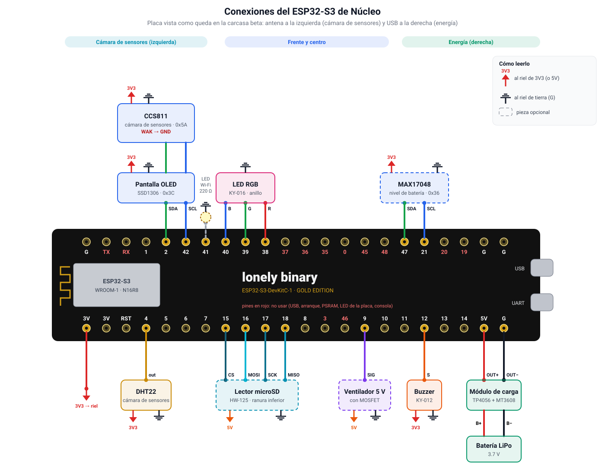

# Conexiones del ESP32

Placa: ESP32-S3-DevKitC-1 N16R8 (Lonely Binary). Los pines se reparten según el
[prototipo beta](../../Docs/nucleo3d/README.md): la placa va **girada** dentro de la carcasa, con la
antena hacia la cámara de sensores (izquierda) y el USB hacia el compartimento de energía
(derecha). Cada pieza usa los pines del lado donde queda, en las dos filas, así que los cables
salen derechos y no se cruzan. Las alimentaciones se marcan con su símbolo (flecha roja de 3V3,
naranja de 5V y tierra): van a los rieles. Las piezas con borde punteado son opcionales y los
pines en rojo no se usan.

| Zona de la carcasa | Componente | Pines del componente → ESP32-S3 | Fila | Alimentación |
| --- | --- | --- | --- | --- |
| Sensores (izq.) | CCS811 | SDA → **2**, SCL → **42**, WAK → G | superior | VCC → 3V3, GND → G |
| Sensores (izq.) | DHT22 | out → **4** | inferior | + → 3V3, − → G |
| Frente | Pantalla OLED SSD1306 | SDA → **2**, SCL → **42** (en cadena con el CCS811) | superior | VCC → 3V3, GND → G |
| Frente | LED de Wi-Fi (opcional) | ánodo → **41** (con resistencia de 220 Ω) | superior | cátodo → G |
| Frente | LED RGB (KY-016) | B → **40**, G → **39**, R → **38** | superior | − → G |
| Frente | Buzzer (KY-012) | S → **12** | inferior | + → 3V3, − → G |
| Borde inferior | Lector microSD HW-125 (opcional) | CS → **15**, MOSI → **16**, SCK → **17**, MISO → **18** | inferior | VCC → **5V**, GND → G |
| Energía (der.) | MAX17048 (opcional) | SDA → **47**, SCL → **21** (bus propio) | superior | VCC → 3V3, GND → G |
| Energía (der.) | Ventilador 5 V (opcional) | MOSFET SIG → **9** | inferior | + → 5V, − → MOSFET → G |
| Energía (der.) | Módulo de carga | OUT+ → **5V**, OUT− → **G** | inferior | Batería en B+ / B− |
| — | Riel de 3.3 V | sale del pin **3V** | inferior | — |

- **Rieles:** uno de **3V3** (desde el pin 3V), uno de **5V** (desde la salida del módulo de carga)
  y uno de **GND** común. Todos los G del dibujo van al riel GND.
- **Dos buses I2C:** la OLED (0x3C) y el CCS811 (0x5A) en 2/42, del lado de los sensores; el
  MAX17048 (0x36) en su propio bus 47/21, junto a la batería, para no cruzar la carcasa con
  cables. Con `PIN_I2C_BATERIA_SDA = None` vuelve a compartir el primer bus. El CCS811 necesita
  **WAK a GND** o no responde.
- **Módulo de carga:** si es solo un TP4056 (sin salida de 5 V), entre OUT+ y el pin 5V va el
  elevador MT3608 ajustado a 5 V. Nunca conectes la batería directo al pin 3V.
- **microSD:** aliméntalo desde 5V (su regulador AMS1117 necesita más de 3.3 V); su chip LVC125A
  ya adapta las señales al ESP. Tarjeta de hasta 32 GB en FAT32.
- **Ventilador:** el pin del ESP no da corriente suficiente; va con un módulo MOSFET y en el
  compartimento de energía, lejos del DHT22 y del CCS811.
- Los pines del microSD (15–18) y del ventilador (9) están reservados en
  `IoT/micropython/config.py`; el firmware todavía no los usa.
- Sigue la serigrafía de cada módulo: el orden de sus pines cambia entre vendedores.

## Relacionado

- [Firmware y hardware](firmware-y-hardware.md): qué hace cada pieza y cómo la usa el firmware.
- [IoT/README](../../IoT/README.md): grabar la placa, subir el código y Pymakr.
- [Núcleo en 3D](../../Docs/nucleo3d/README.md): carcasa beta, dónde va cada pieza y el recorrido
  de los 43 cables con su pin exacto en la placa de expansión.
