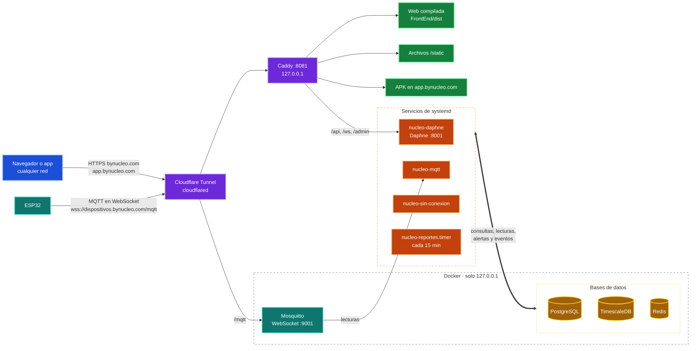

# Servidor de producción

Cómo está publicado Núcleo y qué corre en el servidor. Los comandos de operación, el acceso por
SSH y la instalación desde cero están en [`deploy/README.md`](../../deploy/README.md).

## Direcciones

| Dirección | Para qué |
| --- | --- |
| **https://bynucleo.com** | Web, API de la app (`/api/v1`), panel en vivo y admin |
| **https://app.bynucleo.com** | Descarga de la app Android |
| `dispositivos.bynucleo.com` | Solo para los ESP32: MQTT (dentro de WebSocket) y llave de Nico AI |

Todo llega por un Cloudflare Tunnel, sin abrir puertos en el router. Abrir `dispositivos.` en el
navegador lleva a `bynucleo.com`. Corre en un servidor propio: una
laptop ASUS X75A con Debian 13 sin escritorio (procesador Intel Core i5-3230M de 2 núcleos y 4 hilos a
2.6 GHz, 8 GB de RAM y disco duro mecánico HDD de 750 GB, 698 GB utilizables) que funciona como VPS casero.

## Cómo llega una visita

## Piezas

- **Dominio:** `bynucleo.com` está en Cloudflare; el túnel `nucleo` (servicio `cloudflared`)
  lleva las visitas a Caddy sin abrir puertos en el router. `http://` y `www.` redirigen a
  `https://bynucleo.com`; `app.bynucleo.com` entrega el APK.
- **Subdominio de los ESP32:** Cloudflare solo deja pasar HTTPS, así que los ESP32 hablan MQTT
  dentro de WebSocket en `wss://dispositivos.bynucleo.com/mqtt`; el túnel lo lleva directo al
  listener WebSocket de Mosquitto (solo local). El ESP valida el certificado con las raíces de
  Let's Encrypt y Google que lleva el firmware. En ese subdominio solo quedan además el respaldo
  HTTPS de Nico y la hora (`/api/v1/puente/`, `/api/v1/health/`).
- **Web:** Vite la compila contra la API real y Caddy la sirve como archivos estáticos.
- **API y tiempo real:** Daphne atiende HTTP y WebSocket (`/ws/panel/`) como servicio
  `nucleo-daphne`; Redis reparte los eventos en vivo.
- **Lecturas:** `nucleo-mqtt` recibe las lecturas del broker Mosquitto y las guarda en
  TimescaleDB; `nucleo-sin-conexion` marca los dispositivos que dejan de reportar.
- **Reportes:** `nucleo-reportes.timer` genera cada 15 minutos los reportes programados, con el
  texto redactado por `IA_PROVEEDOR=local`.
- **Correo:** Gmail por SMTP con una contraseña de aplicación de la cuenta del proyecto.
- **Push:** `NUCLEO_PUSH_HABILITADO=true`; el backend envía a Expo, que entrega por Firebase
  (proyecto `nucleo-firebase`) a los teléfonos registrados al iniciar sesión en la app.
- **App:** `deploy/compilar_apk.sh` compila el APK en el mismo servidor y lo publica en
  `https://app.bynucleo.com`.
- **Respaldos:** `nucleo-respaldo.timer` respalda a diario las dos bases y la configuración del
  broker: 7 días en el servidor y 30 en Google Drive.
- **Disponibilidad:** todos los servicios arrancan con el equipo y se reinician solos; los
  contenedores tienen límite de memoria. El equipo no se suspende con la tapa
  cerrada ni por inactividad, usa el cable si está conectado y el Wi-Fi como respaldo.

## Actualizar

Después de subir cambios a `dev`: desde el servidor,
`bash deploy/desplegar.sh` (trae `dev`, migra, recompila y reinicia).

El acceso por SSH desde cualquier red, los comandos de operación y la instalación desde cero
están en [`deploy/README.md`](../../deploy/README.md).
