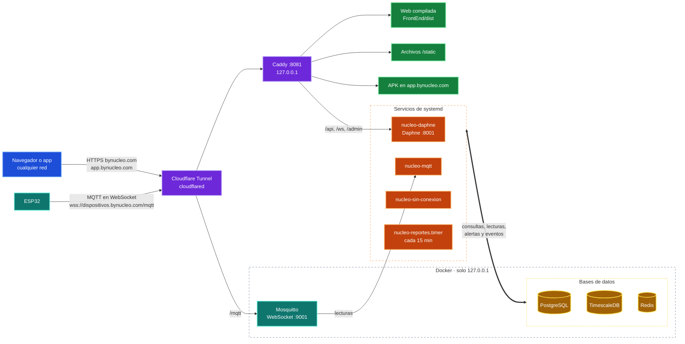

# Servidor de producción

Cómo está publicado Núcleo y qué corre en el servidor. Los comandos de operación, el acceso por
SSH y la instalación desde cero están en [`deploy/README.md`](../../deploy/README.md).

## Direcciones

| Dirección | Para qué |
| --- | --- |
| **https://bynucleo.com** | Web, API de la app (`/api/v1`), panel en vivo y admin |
| **https://app.bynucleo.com** | Descarga de la app Android |
| **https://info.bynucleo.com** | Landing pública: web, app, dispositivo, Nico AI y planes (`Landing/`) |
| **https://nicoai.bynucleo.com** | Consola de Nico AI (solo superusuario) |
| **https://admin.bynucleo.com** | Consola de administración (solo superusuario) |
| `dispositivos.bynucleo.com` | Solo para los ESP32: MQTT (dentro de WebSocket) y llave de Nico AI |

Todo llega por un Cloudflare Tunnel, sin abrir puertos en el router. Abrir `dispositivos.` en el
navegador lleva a `bynucleo.com`. Corre en equipos propios que funcionan como VPS casero, dos
laptops con Debian 13 sin escritorio unidas por Tailscale (que va por un cable Ethernet directo entre
ellas y, si se desconecta, por el Wi-Fi):

| Equipo | Hardware | Papel |
| --- | --- | --- |
| Servidor | Intel Core i5-12450H (8 núcleos, 12 hilos), 8 GB de RAM, NVMe de 512 GB | Atiende todo lo de este diagrama |
| Equipo de compilación y respaldo | Intel Core i5-3230M (2 núcleos, 4 hilos), 8 GB de RAM, HDD de 750 GB | Compila la web y el APK, despliega, respalda, prueba restauraciones y vigila el servidor |

Entre los dos equipos solo viajan órdenes, volcados, la web compilada y el APK: todo lo que se
consulta en cada petición (API, bases, Redis, broker, Ollama) vive en el servidor.

## Cómo llega una visita

## Piezas

- **Dominio:** `bynucleo.com` está en Cloudflare; el túnel `nucleo` (servicio `cloudflared`)
  lleva las visitas a Caddy sin abrir puertos en el router. `http://` y `www.` redirigen a
  `https://bynucleo.com`; `app.bynucleo.com` entrega el APK.
- **Subdominio de los ESP32:** Cloudflare solo deja pasar HTTPS, así que los ESP32 hablan MQTT
  dentro de WebSocket en `wss://dispositivos.bynucleo.com/mqtt`; el túnel lo lleva directo al
  listener WebSocket de Mosquitto (solo local). El ESP valida el certificado con las raíces de
  Let's Encrypt y Google que lleva el firmware. En ese subdominio solo quedan además el respaldo
  HTTPS de Nico, la actualización del firmware y la hora (`/api/v1/puente/`, `/api/v1/health/`).
- **Web:** Vite la compila contra la API real y Caddy la sirve como archivos estáticos.
- **API y tiempo real:** Daphne atiende HTTP y WebSocket (`/ws/panel/`) como servicio
  `nucleo-daphne`; Redis reparte los eventos en vivo.
- **Lecturas:** `nucleo-mqtt` recibe las lecturas del broker Mosquitto y las guarda en
  TimescaleDB; `nucleo-sin-conexion` marca los dispositivos que dejan de reportar.
- **Reportes:** `nucleo-reportes.timer` genera cada 15 minutos los reportes programados, con el
  texto redactado por `IA_PROVEEDOR=local`.
- **Correo:** Gmail por SMTP con una contraseña de aplicación de la cuenta del proyecto.
- **Push:** `NUCLEO_PUSH_HABILITADO=true`; el backend envía a Expo, que entrega por Firebase
  (proyecto `nucleo-firebase`) a los teléfonos registrados al iniciar sesión en la app.
- **App:** el equipo de compilación compila el APK (`deploy/compilar_apk.sh`) y lo copia al
  servidor, que lo publica en `https://app.bynucleo.com`.
- **Respaldos:** el equipo de compilación saca por SSH, todos los días a las 23:30 (RPO de 24 h),
  las dos bases y la configuración del servidor y los guarda 10 días. Cada lunes a las 00:30 arma
  un zip de la semana con una carpeta por día (`lunes/` … `domingo/`) y lo sube a Google Drive
  cifrado con rclone `crypt` (unas 5 semanas); lo que aún no está en Drive puede ser hasta una
  semana. Cada mes restaura el último respaldo en contenedores temporales, compara con
  producción, mide el RTO y revisa que el último zip esté en Drive.
- **Seguridad:** firewall ufw que solo deja entrar por Tailscale, reglas WAF y límite de acceso
  en Cloudflare, avisos por correo cuando falla un servicio, un vigilante externo en el equipo de
  compilación y el vigía de GitHub Actions ([seguridad](../seguridad/seguridad.md)).
- **Disponibilidad:** todos los servicios arrancan con el equipo y se reinician solos; los
  contenedores tienen límite de memoria. El servidor **descansa de 06:00 a 12:00**: a las 06:00
  se actualiza (`apt upgrade`), reinicia si instaló algo, se suspende y el reloj lo despierta a las
  12:00; en ese horario Núcleo no responde ni guarda lecturas, y el vigilante y el vigía de GitHub
  no lo revisan. Desde el equipo de compilación, `despertar-lenovo` lo despierta antes. Fuera de
  ese horario los equipos no se suspenden con la tapa cerrada ni por inactividad; el equipo de
  compilación nunca se suspende y se actualiza a mano (`mantenimiento-asus`). Van por Wi-Fi con IP fija y una red de respaldo, y el túnel usa `http2` (TCP), que
  aguanta mejor los baches de señal que QUIC. Sin corriente y con poca batería se apagan en orden.

## Operación en dos equipos

| Qué | Dónde | Cuándo |
| --- | --- | --- |
| Despliegue (`desplegar-nucleo`: compila la web, la copia y el servidor instala) | Equipo de compilación | A mano, tras unir `dev` a `main` |
| Build del APK (`compilar-apk-nucleo`, ~8 min con cambios en `Mobile/`) | Equipo de compilación | Solo cuando se pide; nunca dos a la vez |
| Respaldo diario (`respaldo-nucleo-remoto.timer`: bases, aplicación, broker y archivos, firma de la app) | Equipo de compilación, por SSH | Todos los días 23:30 (se guarda 10 días ahí) |
| Zip semanal cifrado a Drive (`respaldo-nucleo-semanal.timer`) | Equipo de compilación | Lunes 00:30 (unas 5 semanas en Drive) |
| Prueba de restauración (`prueba-restauracion-nucleo-remoto.timer`) | Equipo de compilación | Primer domingo del mes, 04:30 |
| Descanso diario (`descanso-lenovo.timer`: `apt upgrade`, reinicio si hace falta, suspensión) | Servidor | 06:00 a 12:00 |
| Vigilante externo (`vigia`) | Equipo de compilación | Cada 60 s (no revisa 06:00-12:10 si el servidor duerme) |
| Vigía de GitHub Actions (`.github/workflows/vigia.yml`) | GitHub | Cada 15 min (salta 06:00-12:10) |
| Reportes programados (`nucleo-reportes.timer`) y recursos (`nucleo-recursos.timer`) | Servidor | Cada 15 y 10 min |
| Actualización del equipo de compilación (`mantenimiento-asus`) | Equipo de compilación | A mano |

- `desplegar-nucleo` y `compilar-apk-nucleo` usan candado (`flock`): si ya hay uno en curso, el
  segundo se niega. El descanso tampoco suspende el servidor si hay un despliegue o una build en
  curso. No se despliega durante el descanso; `despertar-lenovo` (desde el equipo de compilación)
  despierta antes al servidor con un *magic packet* por Wi-Fi.
- Si el equipo de compilación se apaga, Núcleo sigue igual: solo se pausan despliegues, builds,
  respaldos y el vigilante (el vigía de GitHub sigue). Si cae el servidor, cae Núcleo; no hay
  conmutación automática ([Servidor de reserva](../../deploy/README.md#servidor-de-reserva)).
- **Nico AI** usa el Ollama del servidor (contenedor `nucleo_ollama`, tope de 3.5 GB, un modelo
  cargado, 2 peticiones en paralelo y cola de 8): `qwen3:4b-instruct` sin «thinking», `num_ctx` 2048
  y 3 hilos, espera máxima `IA_ESPERA_SEGUNDOS=40`; `qwen2.5:1.5b` queda de reserva para equipos con
  menos memoria. Detalle en [Nico AI](../agente/nico-ai.md).
- **Vigilancia:** `nucleo-aviso@.service` y `vigilar_recursos.sh` avisan desde el servidor; el
  vigilante externo y el vigía de GitHub, desde fuera. El panel del servidor
  (`hostprojects.bynucleo.com`, con usuario y contraseña, fuera del repo) usa el mismo túnel y
  muestra el estado de Núcleo, sus respaldos y los trabajos en curso. Detalle en
  [`deploy/README.md`](../../deploy/README.md#avisos-y-vigilancia).

## Actualizar

Producción corre la rama `main`. Cuando `dev` está probada en local, se une a `main`
(avance rápido) y desde el equipo de compilación se ejecuta `desplegar-nucleo`: compila la web,
la copia al servidor y ahí corre `NUCLEO_SIN_WEB=1 bash deploy/desplegar.sh` (trae `main`, migra
y reinicia). Si ese equipo no está, `bash deploy/desplegar.sh` en el servidor hace todo, web
incluida.

El acceso por SSH desde cualquier red, los comandos de operación y la instalación desde cero
están en [`deploy/README.md`](../../deploy/README.md).
