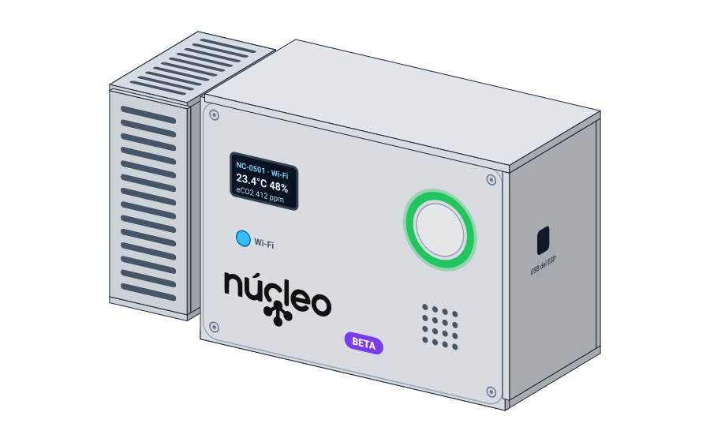
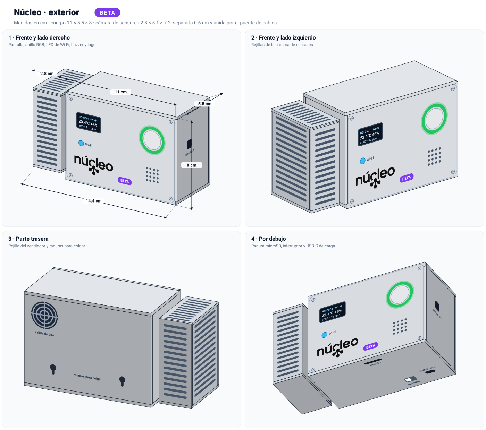
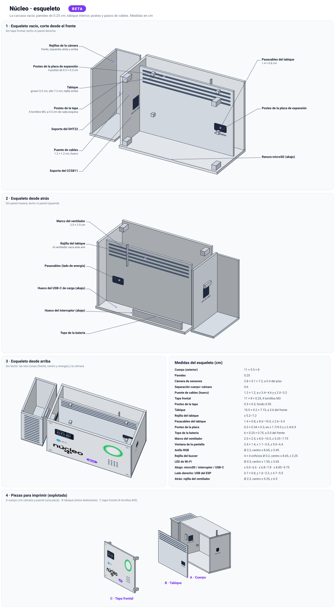
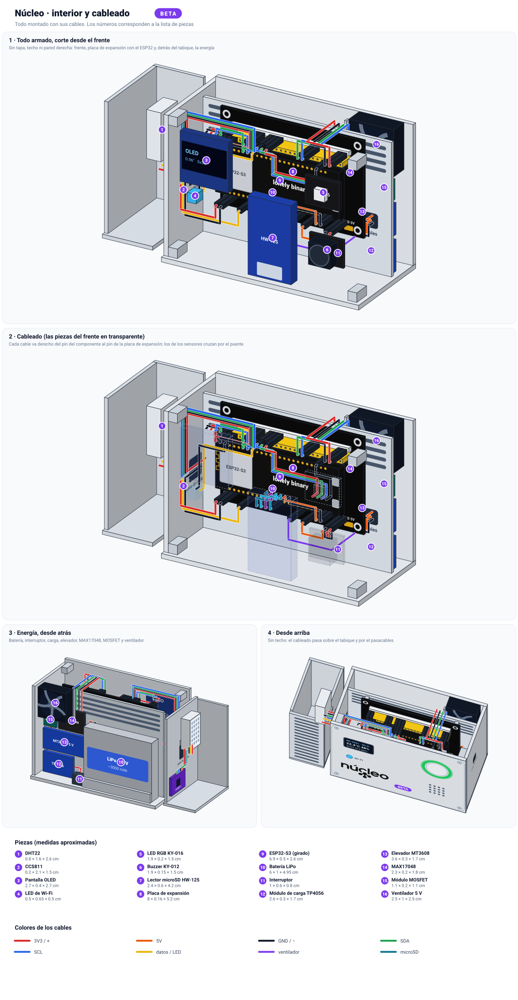
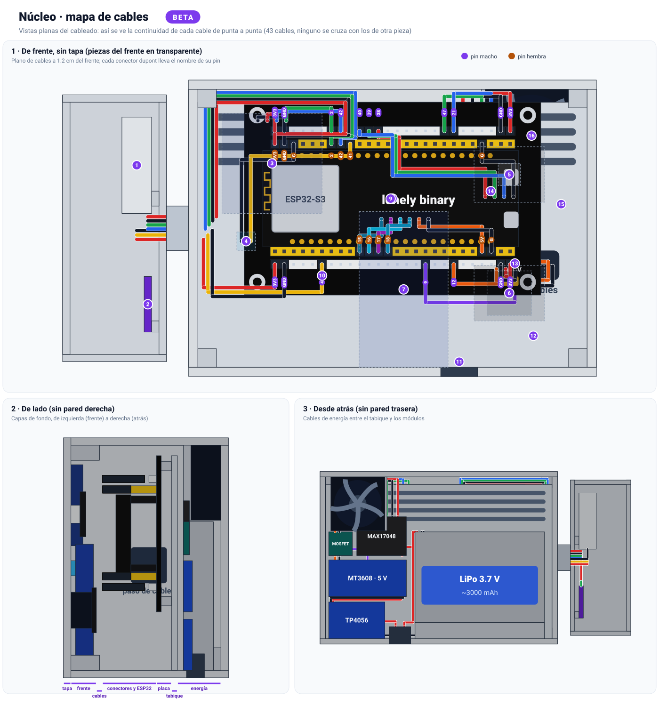
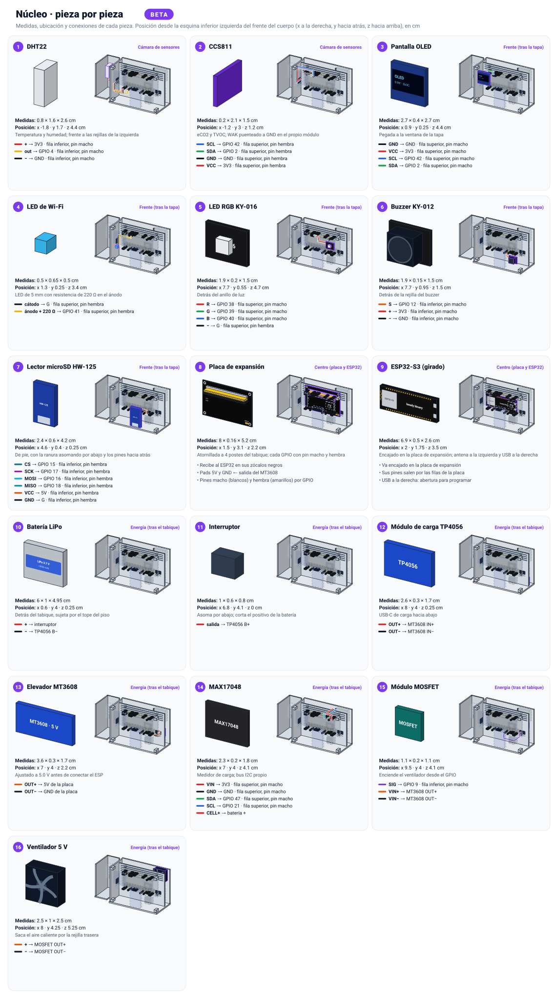
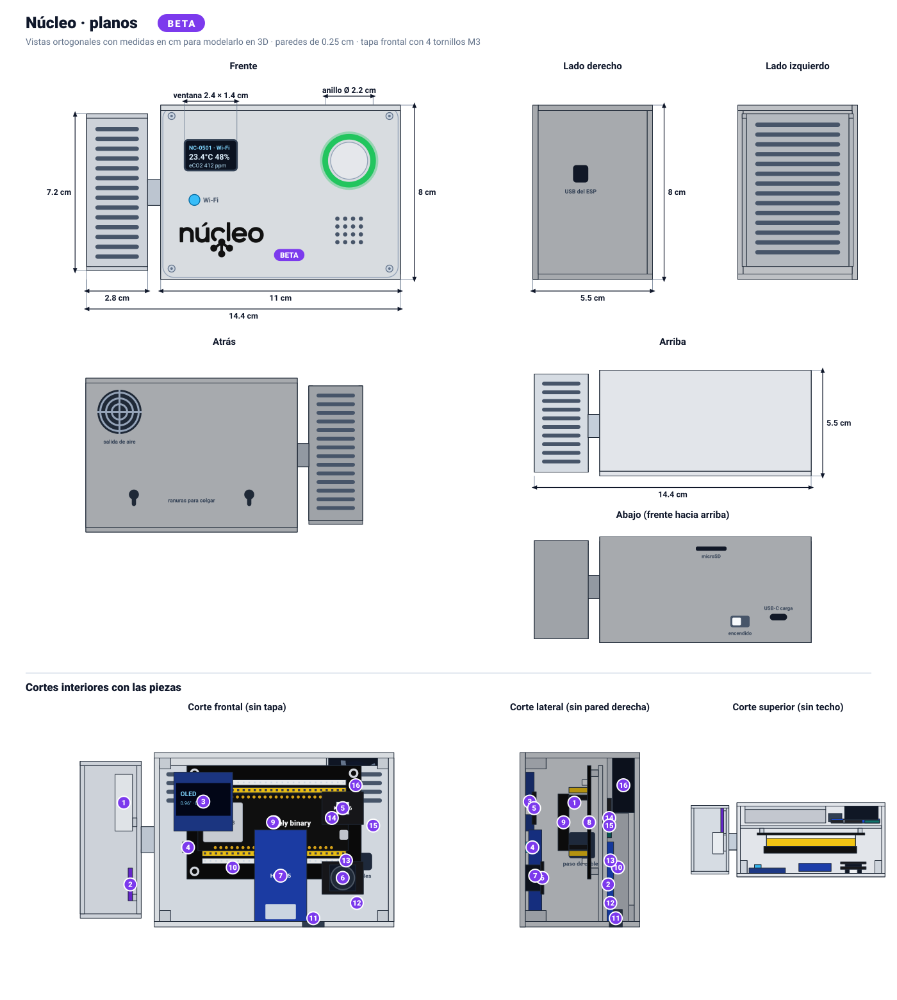

# Núcleo en 3D (beta)

Referencia visual para modelar e imprimir la carcasa de Núcleo. Es una **versión beta**: las
medidas son aproximadas y se confirman con los módulos reales antes de imprimir. Todas las
hojas salen del mismo modelo, así que las medidas, las posiciones y los cables coinciden entre
sí. Las medidas van en **centímetros**.

## Hojas

| Hoja | Qué muestra |
| --- | --- |
| [Exterior](exterior.svg) | Cuatro perspectivas (frente y ambos lados, atrás y por debajo) con las medidas generales |
| [Esqueleto](esqueleto.svg) | La carcasa vacía: tabique, postes, pasos de cables, tabla de medidas y las piezas para imprimir |
| [Interior y cableado](interior.svg) | Todo montado con sus cables: corte desde el frente, con el frente transparente, la energía desde atrás y desde arriba |
| [Mapa de cables](cableado.svg) | Vistas planas del cableado con el nombre de cada pin, de lado (capas de fondo) y desde atrás |
| [Pieza por pieza](piezas.svg) | Una tarjeta por pieza: medidas, posición, dónde va en la carcasa y a qué pin va cada cable |
| [Planos](planos.svg) | Vistas ortogonales con medidas y cortes interiores |

### Exterior

### Esqueleto (vacío)

### Interior y cableado

### Mapa de cables

### Pieza por pieza

### Planos

## Cómo está armado

- **Cuerpo:** 11 × 5.5 × 8 cm, paredes de 0.25 cm. Se arma por el frente: la **tapa frontal**
  (11 × 8 × 0.25 cm) se atornilla con 4 tornillos M3 a los postes de las esquinas.
- **Cámara de sensores:** 2.8 × 5.1 × 7.2 cm a la izquierda, separada 0.6 cm del cuerpo para que
  no le llegue el calor. Solo la une un **puente hueco** de 1.2 × 1.2 cm por donde pasan los
  cables del DHT22 y del CCS811. Rejillas al frente, a la izquierda, atrás y arriba.
- **Tres capas de fondo**, de adelante hacia atrás:
  1. **Frente** (0.25–1.1 cm): pantalla, LED de Wi-Fi, LED RGB, buzzer y lector microSD, pegados
     a la tapa.
  2. **Centro** (1.1–3.6 cm): plano de cables a 1.2 cm, los conectores dupont, el ESP32 y la
     **placa de expansión** atornillada con 4 postes al tabique. Cada GPIO de la placa tiene un pin
     macho (blanco) y uno hembra (amarillo), y hay 3V3 y GND en cada extremo de las dos filas: así
     la pantalla y el CCS811 comparten el bus I2C sin empalmes (uno en el macho y otro en la hembra).
  3. **Energía** (3.8–5.25 cm), detrás del **tabique**: batería, interruptor, TP4056, MT3608,
     MAX17048, MOSFET y ventilador. El tabique tiene rejilla arriba (el ventilador saca ese aire por
     atrás) y un pasacables abajo a la derecha.
- **El ESP32 va girado:** antena hacia la cámara de sensores y USB hacia la energía, igual que en
  el diagrama de conexiones del README principal.

## Piezas

Posición: esquina inferior izquierda delantera de cada pieza, medida desde la esquina inferior
izquierda del frente del cuerpo (x a la derecha, y hacia atrás, z hacia arriba).

| # | Pieza | Zona | Tamaño x × y × z (cm) | Posición x · y · z (cm) |
| --- | --- | --- | --- | --- |
| 1 | DHT22 | Cámara de sensores | 0.8 × 1.6 × 2.6 | -1.8 · 1.7 · 4.4 |
| 2 | CCS811 | Cámara de sensores | 0.2 × 2.1 × 1.5 | -1.2 · 3 · 1.2 |
| 3 | Pantalla OLED | Frente | 2.7 × 0.4 × 2.7 | 0.9 · 0.25 · 4.4 |
| 4 | LED de Wi-Fi | Frente | 0.5 × 0.65 × 0.5 | 1.3 · 0.25 · 3.4 |
| 5 | LED RGB KY-016 | Frente | 1.9 × 0.2 × 1.5 | 7.7 · 0.55 · 4.7 |
| 6 | Buzzer KY-012 | Frente | 1.9 × 0.15 × 1.5 | 7.7 · 0.95 · 1.5 |
| 7 | Lector microSD HW-125 | Frente | 2.4 × 0.6 × 4.2 | 4.6 · 0.4 · 0.25 |
| 8 | Placa de expansión | Centro | 8 × 0.16 × 5.2 | 1.5 · 3.1 · 2.2 |
| 9 | ESP32-S3 (girado) | Centro | 6.9 × 0.5 × 2.6 | 2 · 1.75 · 3.5 |
| 10 | Batería LiPo | Energía | 6 × 1 × 4.95 | 0.6 · 4 · 0.25 |
| 11 | Interruptor | Energía | 1 × 0.6 × 0.8 | 6.8 · 4.1 · 0 |
| 12 | Módulo de carga TP4056 | Energía | 2.6 × 0.3 × 1.7 | 8 · 4 · 0.25 |
| 13 | Elevador MT3608 | Energía | 3.6 × 0.3 × 1.7 | 7 · 4 · 2.2 |
| 14 | MAX17048 | Energía | 2.3 × 0.2 × 1.8 | 7 · 4 · 4.1 |
| 15 | Módulo MOSFET | Energía | 1.1 × 0.2 × 1.1 | 9.5 · 4 · 4.1 |
| 16 | Ventilador 5 V | Energía | 2.5 × 1 × 2.5 | 8 · 4.25 · 5.25 |

## Cables

43 cables. Se revisaron con el modelo:

- **Continuidad:** cada cable sale del pin de su componente y llega a su pin, sin cortes.
- **Sin choques:** ningún cable atraviesa otra pieza ni una pared; solo cruzan por el puente, el
  pasacables o por encima del tabique.
- **Sin cruces:** ningún cable se cruza con los de otra pieza en el plano de cables del frente.

Los de la placa de expansión llegan con conector dupont: hembra en los pines macho y macho en los
pines hembra. El largo es aproximado (por el recorrido); deja 2 o 3 cm de holgura.

| Pieza | Pin | Va a | Pasa por | Largo |
| --- | --- | --- | --- | --- |
| DHT22 | + | **3V3** (placa de expansión, fila inferior, pin macho) | puente de cables | 8 cm |
| DHT22 | out | **GPIO 4** (placa de expansión, fila inferior, pin macho) | puente de cables | 9 cm |
| DHT22 | − | **GND** (placa de expansión, fila inferior, pin macho) | puente de cables | 9 cm |
| CCS811 | SCL | **GPIO 42** (placa de expansión, fila superior, pin hembra) | puente de cables | 15 cm |
| CCS811 | SDA | **GPIO 2** (placa de expansión, fila superior, pin hembra) | puente de cables | 15 cm |
| CCS811 | GND | **GND** (placa de expansión, fila superior, pin hembra) | puente de cables | 16 cm |
| CCS811 | VCC | **3V3** (placa de expansión, fila superior, pin hembra) | puente de cables | 15 cm |
| Pantalla OLED | GND | **GND** (placa de expansión, fila superior, pin macho) | directo | 1 cm |
| Pantalla OLED | VCC | **3V3** (placa de expansión, fila superior, pin macho) | directo | 1 cm |
| Pantalla OLED | SCL | **GPIO 42** (placa de expansión, fila superior, pin macho) | directo | 3 cm |
| Pantalla OLED | SDA | **GPIO 2** (placa de expansión, fila superior, pin macho) | directo | 2 cm |
| LED de Wi-Fi | cátodo | **G** (placa de expansión, fila superior, pin hembra) | directo | 4 cm |
| LED de Wi-Fi | ánodo + 220 Ω | **GPIO 41** (placa de expansión, fila superior, pin hembra) | directo | 6 cm |
| LED RGB KY-016 | R | **GPIO 38** (placa de expansión, fila superior, pin macho) | directo | 5 cm |
| LED RGB KY-016 | G | **GPIO 39** (placa de expansión, fila superior, pin macho) | directo | 6 cm |
| LED RGB KY-016 | B | **GPIO 40** (placa de expansión, fila superior, pin macho) | directo | 6 cm |
| LED RGB KY-016 | − | **G** (placa de expansión, fila superior, pin hembra) | directo | 3 cm |
| Buzzer KY-012 | S | **GPIO 12** (placa de expansión, fila inferior, pin macho) | directo | 2 cm |
| Buzzer KY-012 | + | **3V3** (placa de expansión, fila inferior, pin macho) | directo | 1 cm |
| Buzzer KY-012 | − | **GND** (placa de expansión, fila inferior, pin macho) | directo | 1 cm |
| Lector microSD HW-125 | CS | **GPIO 15** (placa de expansión, fila inferior, pin hembra) | directo | 2 cm |
| Lector microSD HW-125 | SCK | **GPIO 17** (placa de expansión, fila inferior, pin hembra) | directo | 2 cm |
| Lector microSD HW-125 | MOSI | **GPIO 16** (placa de expansión, fila inferior, pin hembra) | directo | 2 cm |
| Lector microSD HW-125 | MISO | **GPIO 18** (placa de expansión, fila inferior, pin hembra) | directo | 2 cm |
| Lector microSD HW-125 | VCC | **5V** (placa de expansión, fila inferior, pin hembra) | directo | 3 cm |
| Lector microSD HW-125 | GND | **G** (placa de expansión, fila inferior, pin hembra) | directo | 3 cm |
| MAX17048 | VIN | **3V3** (placa de expansión, fila superior, pin macho) | sobre el tabique | 7 cm |
| MAX17048 | GND | **GND** (placa de expansión, fila superior, pin macho) | sobre el tabique | 6 cm |
| MAX17048 | SDA | **GPIO 47** (placa de expansión, fila superior, pin macho) | sobre el tabique | 7 cm |
| MAX17048 | SCL | **GPIO 21** (placa de expansión, fila superior, pin macho) | sobre el tabique | 7 cm |
| MAX17048 | CELL+ | batería + | directo | 1 cm |
| Módulo MOSFET | SIG | **GPIO 9** (placa de expansión, fila inferior, pin macho) | pasacables del tabique, detrás de la placa | 10 cm |
| Módulo MOSFET | VIN+ | MT3608 OUT+ | directo | 0 cm |
| Módulo MOSFET | VIN− | MT3608 OUT− | directo | 0 cm |
| Ventilador 5 V | + | MOSFET OUT+ | directo | 1 cm |
| Ventilador 5 V | − | MOSFET OUT− | directo | 1 cm |
| Batería LiPo | + | interruptor | directo | 5 cm |
| Batería LiPo | − | TP4056 B− | directo | 7 cm |
| Interruptor | salida | TP4056 B+ | directo | 1 cm |
| Módulo de carga TP4056 | OUT+ | MT3608 IN+ | directo | 4 cm |
| Módulo de carga TP4056 | OUT− | MT3608 IN− | directo | 5 cm |
| Elevador MT3608 | OUT+ | 5V de la placa | detrás de la placa | 4 cm |
| Elevador MT3608 | OUT− | GND de la placa | detrás de la placa | 5 cm |

- El CCS811 lleva su pin **WAK** puenteado a GND en el propio módulo.
- El MT3608 se ajusta a **5.0 V** antes de conectarlo a la placa de expansión.
