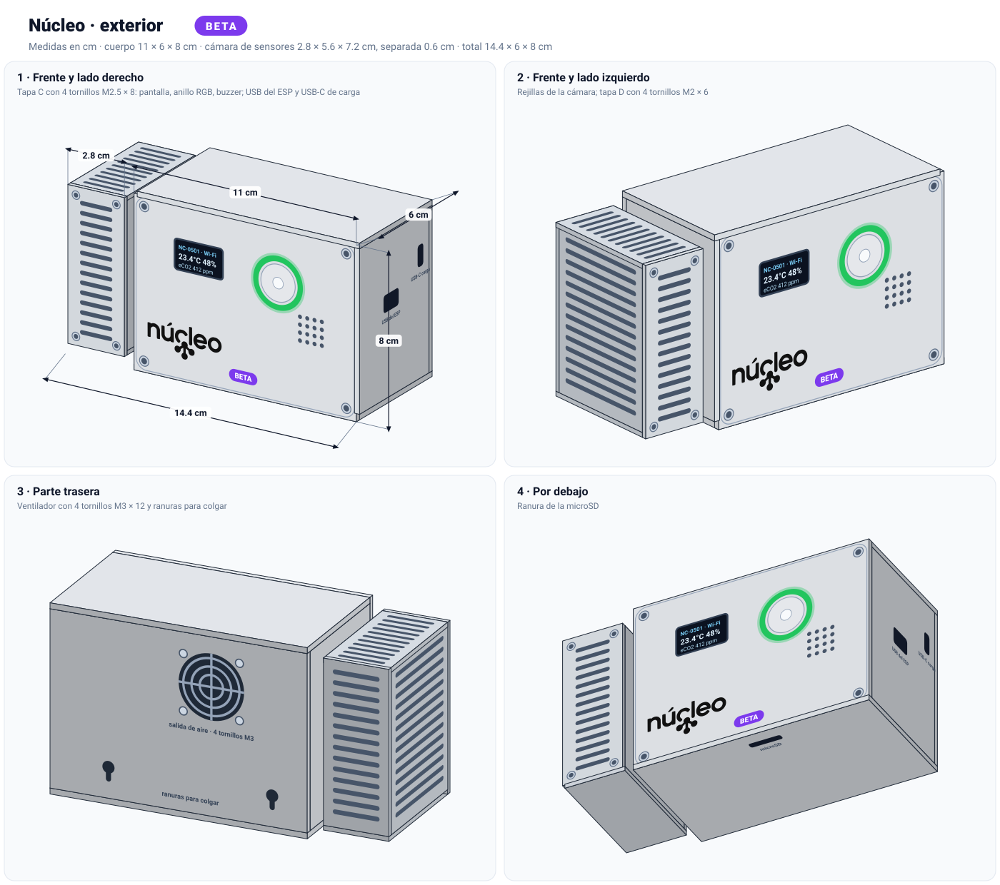
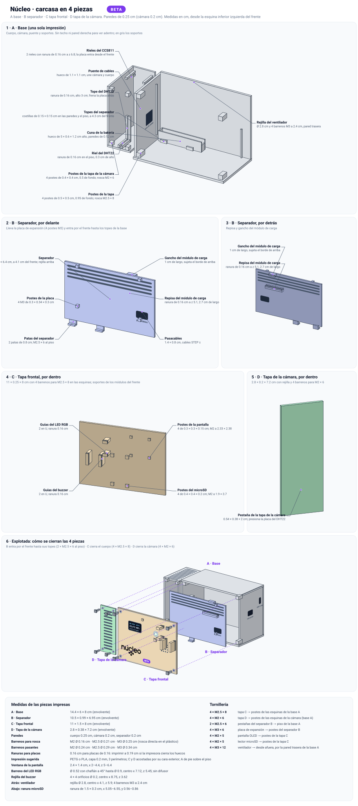
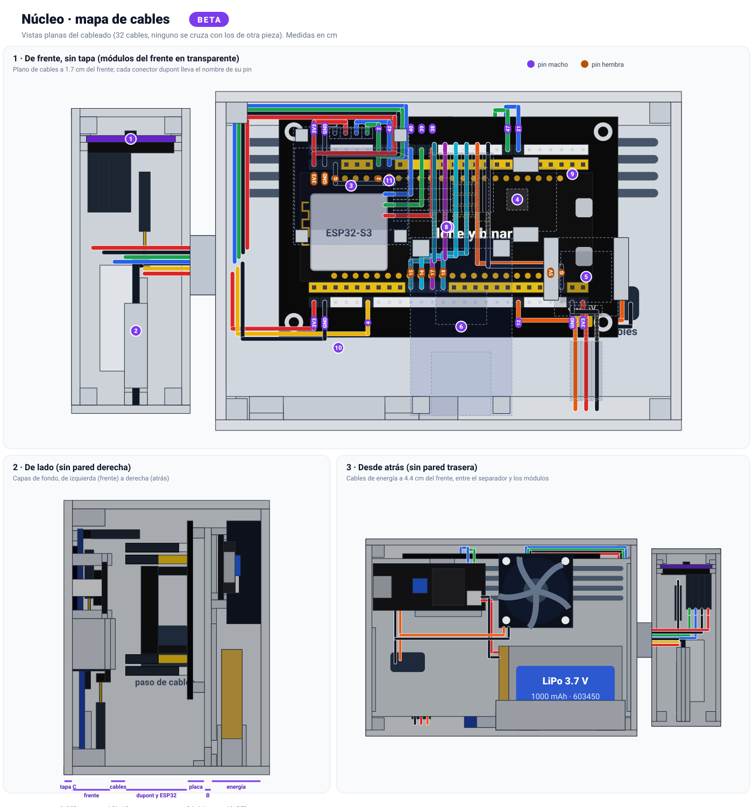

# Núcleo en 3D (beta)

Referencia visual para modelar e imprimir la carcasa de Núcleo. Es una **versión beta**: las
medidas son aproximadas y se confirman con los módulos reales antes de imprimir. Todas las
hojas salen del mismo modelo, así que las medidas, las posiciones y los cables coinciden entre
sí. Las medidas van en **centímetros**.


## Hojas

| Hoja | Qué muestra |
| --- | --- |
| [Exterior](exterior.svg) | Cuatro perspectivas (frente y ambos lados, atrás y por debajo) con las medidas generales |
| [Esqueleto](esqueleto.svg) | La carcasa vacía: tabique, postes, pasos de cables, tabla de medidas y las piezas para imprimir |
| [Interior y cableado](interior.svg) | Todo montado con sus cables: corte desde el frente, con el frente transparente, la energía desde atrás y desde arriba |
| [Mapa de cables](cableado.svg) | Vistas planas del cableado con el nombre de cada pin, de lado (capas de fondo) y desde atrás |
| [Pieza por pieza](piezas.svg) | Una tarjeta por pieza: medidas, posición, dónde va en la carcasa y a qué pin va cada cable |
| [Planos](planos.svg) | Vistas ortogonales con medidas y cortes interiores |

### Exterior



### Esqueleto (vacío)



### Interior y cableado


### Mapa de cables



### Pieza por pieza


### Planos


## Cómo está armado

- **El ESP32 va acostado y girado:** antena hacia la cámara de sensores (izquierda), USB a la
  derecha y la fila de los pines **19, 20 y 21 arriba**. Cada pieza queda del lado de los pines
  que usa, igual que en el prototipo armado:
  - **Arriba (lado 19-21):** pantalla OLED, LED RGB, CCS811 y módulo de carga.
  - **Abajo (lado contrario):** buzzer, lector microSD y DHT22.
- **Cuerpo:** 11 × 5.5 × 8 cm, paredes de 0.25 cm. Se arma por el frente: la **tapa frontal**
  (11 × 8 × 0.25 cm) se atornilla con 4 tornillos M3 a los postes de las esquinas.
- **Cámara de sensores:** 2.8 × 5.1 × 7.2 cm a la izquierda, separada 0.6 cm del cuerpo para que
  no le llegue el calor. El **CCS811 va arriba** y el **DHT22 abajo** (con los pines hacia
  arriba): el calor del CCS811 sube y no llega al DHT22. Solo la une un **puente hueco** de
  1.2 × 1.2 cm por donde pasan los cables de los dos. Rejillas al frente, a la izquierda, atrás y
  arriba.
- **Tres capas de fondo**, de adelante hacia atrás:
  1. **Frente** (0.25–1.1 cm): pantalla, LED RGB, buzzer y lector microSD, pegados
     a la tapa.
  2. **Centro** (1.1–3.6 cm): plano de cables a 1.2 cm, los conectores dupont, el ESP32 y la
     **placa de expansión** atornillada con 4 postes al tabique. Cada GPIO de la placa tiene un pin
     macho (blanco) y uno hembra (amarillo), y hay 3V3 y GND en cada extremo de las dos filas: así
     la pantalla y el CCS811 comparten el bus I2C sin empalmes (uno en el macho y otro en la hembra).
  3. **Energía** (3.8–5.25 cm), detrás del **tabique**: arriba a la derecha el **módulo de carga
     UNIT LiPo Boost & I2C** (cargador, elevador a 5 V y MAX17048 en una placa, sobre una repisa),
     con su **USB-C de carga por el lado derecho**; abajo a la izquierda la **batería LiPo de
     1000 mAh** (5 × 3.4 × 0.6 cm) de pie contra su tope; arriba al centro el **ventilador de
     3 cm** contra la pared trasera, conectado a la salida STEP del módulo. El tabique tiene rejilla arriba
     (el ventilador saca ese aire por atrás) y un pasacables abajo a la derecha.
- **Jumpers cortos:** la pantalla, el LED RGB, el lector microSD y el buzzer usan jumpers dupont
  de **10 cm**. Sus recorridos miden menos de 7 cm; lo que sobra se dobla en el canal libre que
  queda arriba de la fila superior (o abajo de la inferior) de la placa de expansión.
- Solo lleva las piezas del prototipo armado: sin LED de Wi-Fi, sin MOSFET (el ventilador gira
  siempre que hay 5 V) y sin interruptor aparte (la batería va en el JST del módulo de carga).

## Piezas

Posición: esquina inferior izquierda delantera de cada pieza, medida desde la esquina inferior
izquierda del frente del cuerpo (x a la derecha, y hacia atrás, z hacia arriba). La batería, el
ventilador y el módulo de carga van con medidas estimadas: confírmalas antes de imprimir.

| # | Pieza | Zona | Tamaño x × y × z (cm) | Posición x · y · z (cm) |
| --- | --- | --- | --- | --- |
| 1 | CCS811 | Cámara de sensores | 0.2 × 2.1 × 1.5 | -1.2 · 3 · 5 |
| 2 | DHT22 | Cámara de sensores | 0.8 × 1.6 × 2.6 | -1.8 · 1.7 · 0.8 |
| 3 | Pantalla OLED | Frente | 2.7 × 0.4 × 2.7 | 0.9 · 0.25 · 4.4 |
| 4 | LED RGB KY-016 | Frente | 1.9 × 0.2 × 1.5 | 7.7 · 0.55 · 4.7 |
| 5 | Buzzer KY-012 | Frente | 1.9 × 0.15 × 1.5 | 7.7 · 0.95 · 1.5 |
| 6 | Lector microSD HW-125 | Frente | 2.4 × 0.6 × 4.2 | 4.6 · 0.4 · 0.25 |
| 7 | Placa de expansión | Centro | 8 × 0.16 × 5.2 | 1.5 · 3.1 · 2.2 |
| 8 | ESP32-S3 (girado) | Centro | 6.9 × 0.5 × 2.6 | 2 · 1.75 · 3.5 |
| 9 | Módulo de carga UNIT | Energía | 4.2 × 0.35 × 2.6 | 6.4 · 4 · 4.6 |
| 10 | Batería LiPo | Energía | 5 × 0.6 × 3.4 | 0.6 · 4 · 0.25 |
| 11 | Ventilador 5 V | Energía | 3 × 1 × 3 | 3 · 4.25 · 4.4 |

## Cables

32 cables. Se revisaron con el modelo:

- **Continuidad:** cada cable sale del pin de su componente y llega a su pin, sin cortes.
- **Sin choques:** ningún cable atraviesa otra pieza ni una pared; solo cruzan por el puente, el
  pasacables o por encima del tabique.
- **Sin cruces:** ningún cable se cruza con los de otra pieza en el plano de cables del frente.

Los de la placa de expansión llegan con conector dupont: hembra en los pines macho y macho en los
pines hembra. El largo de los demás es aproximado (por el recorrido); deja 2 o 3 cm de holgura.

| Pieza | Pin | Va a | Pasa por | Cable |
| --- | --- | --- | --- | --- |
| DHT22 | + | **3V3** (placa de expansión, fila inferior, pin macho) | puente de cables | 7 cm |
| DHT22 | out | **GPIO 4** (placa de expansión, fila inferior, pin macho) | puente de cables | 9 cm |
| DHT22 | − | **GND** (placa de expansión, fila inferior, pin macho) | puente de cables | 9 cm |
| CCS811 | SCL | **GPIO 42** (placa de expansión, fila superior, pin hembra) | puente de cables | 15 cm |
| CCS811 | SDA | **GPIO 2** (placa de expansión, fila superior, pin hembra) | puente de cables | 15 cm |
| CCS811 | GND | **GND** (placa de expansión, fila superior, pin hembra) | puente de cables | 15 cm |
| CCS811 | VCC | **3V3** (placa de expansión, fila superior, pin hembra) | puente de cables | 14 cm |
| Pantalla OLED | GND | **GND** (placa de expansión, fila superior, pin macho) | directo | jumper de 10 cm (recorrido 1 cm) |
| Pantalla OLED | VCC | **3V3** (placa de expansión, fila superior, pin macho) | directo | jumper de 10 cm (recorrido 1 cm) |
| Pantalla OLED | SCL | **GPIO 42** (placa de expansión, fila superior, pin macho) | directo | jumper de 10 cm (recorrido 3 cm) |
| Pantalla OLED | SDA | **GPIO 2** (placa de expansión, fila superior, pin macho) | directo | jumper de 10 cm (recorrido 2 cm) |
| LED RGB KY-016 | R | **GPIO 38** (placa de expansión, fila superior, pin macho) | directo | jumper de 10 cm (recorrido 5 cm) |
| LED RGB KY-016 | G | **GPIO 39** (placa de expansión, fila superior, pin macho) | directo | jumper de 10 cm (recorrido 6 cm) |
| LED RGB KY-016 | B | **GPIO 40** (placa de expansión, fila superior, pin macho) | directo | jumper de 10 cm (recorrido 6 cm) |
| LED RGB KY-016 | − | **G** (placa de expansión, fila superior, pin hembra) | directo | jumper de 10 cm (recorrido 3 cm) |
| Buzzer KY-012 | S | **GPIO 12** (placa de expansión, fila inferior, pin macho) | directo | jumper de 10 cm (recorrido 2 cm) |
| Buzzer KY-012 | + | **3V3** (placa de expansión, fila inferior, pin macho) | directo | jumper de 10 cm (recorrido 1 cm) |
| Buzzer KY-012 | − | **GND** (placa de expansión, fila inferior, pin macho) | directo | jumper de 10 cm (recorrido 1 cm) |
| Lector microSD HW-125 | CS | **GPIO 15** (placa de expansión, fila inferior, pin hembra) | directo | jumper de 10 cm (recorrido 2 cm) |
| Lector microSD HW-125 | SCK | **GPIO 17** (placa de expansión, fila inferior, pin hembra) | directo | jumper de 10 cm (recorrido 2 cm) |
| Lector microSD HW-125 | MOSI | **GPIO 16** (placa de expansión, fila inferior, pin hembra) | directo | jumper de 10 cm (recorrido 2 cm) |
| Lector microSD HW-125 | MISO | **GPIO 18** (placa de expansión, fila inferior, pin hembra) | directo | jumper de 10 cm (recorrido 2 cm) |
| Lector microSD HW-125 | VCC | **5V** (placa de expansión, fila inferior, pin hembra) | directo | jumper de 10 cm (recorrido 3 cm) |
| Lector microSD HW-125 | GND | **G** (placa de expansión, fila inferior, pin hembra) | directo | jumper de 10 cm (recorrido 3 cm) |
| Módulo de carga UNIT | SDA | **GPIO 47** (placa de expansión, fila superior, pin macho) | sobre el tabique | 4 cm |
| Módulo de carga UNIT | SCL | **GPIO 21** (placa de expansión, fila superior, pin macho) | sobre el tabique | 5 cm |
| Módulo de carga UNIT | STEP + | 5V de la placa | pasacables del tabique, detrás de la placa | 4 cm |
| Módulo de carga UNIT | STEP − | GND de la placa | pasacables del tabique, detrás de la placa | 4 cm |
| Ventilador 5 V | + | STEP + del módulo de carga | directo | 5 cm |
| Ventilador 5 V | − | STEP − del módulo de carga | directo | 6 cm |
| Batería LiPo | + | JST + del módulo de carga | directo | 2 cm |
| Batería LiPo | − | JST − del módulo de carga | directo | 2 cm |

- El CCS811 lleva su pin **WAK** puenteado a GND en el propio módulo.
- La salida **STEP** del módulo de carga se ajusta a **5.0 V** (switch STEP UP en ON) antes de
  conectarla a la placa de expansión; ver [Conexiones del ESP32](../../Context/iot/conexiones.md#batería).

## Generador

Las hojas y este README salen de `generador/` (Python 3, sin dependencias):

```bash
cd Docs/nucleo3d/generador
python3 verificar.py   # continuidad, choques y cruces de los cables
python3 render2.py     # las 7 hojas SVG
python3 readme.py      # este README
```

Las medidas y posiciones de las piezas están en `modelo2.py`.
