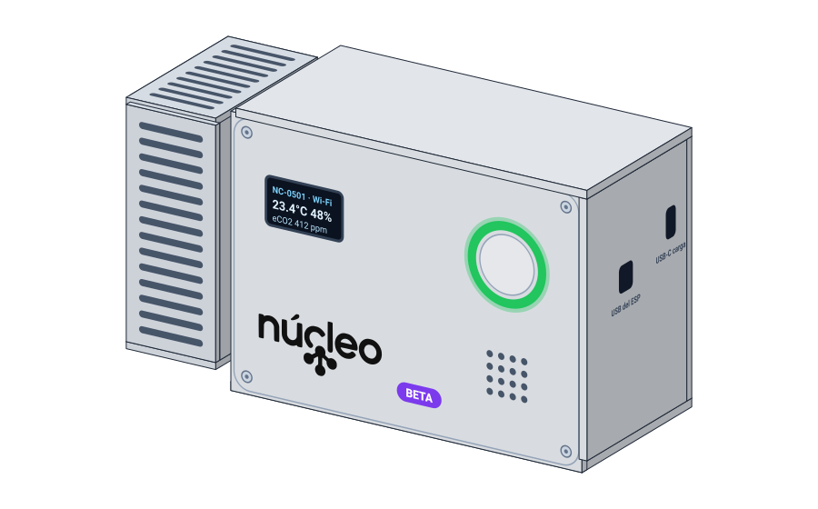
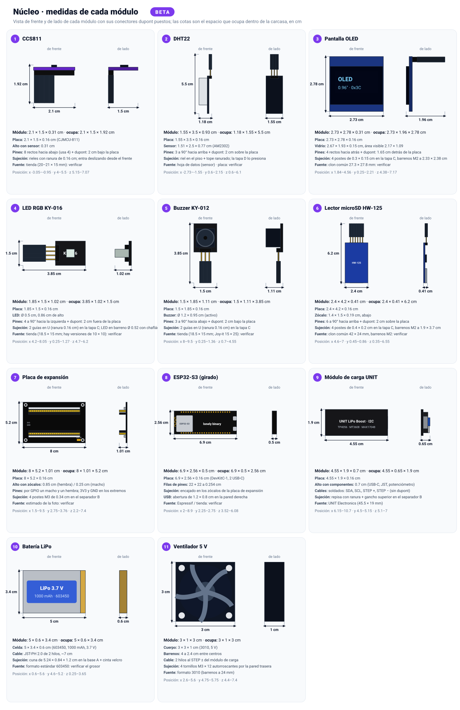
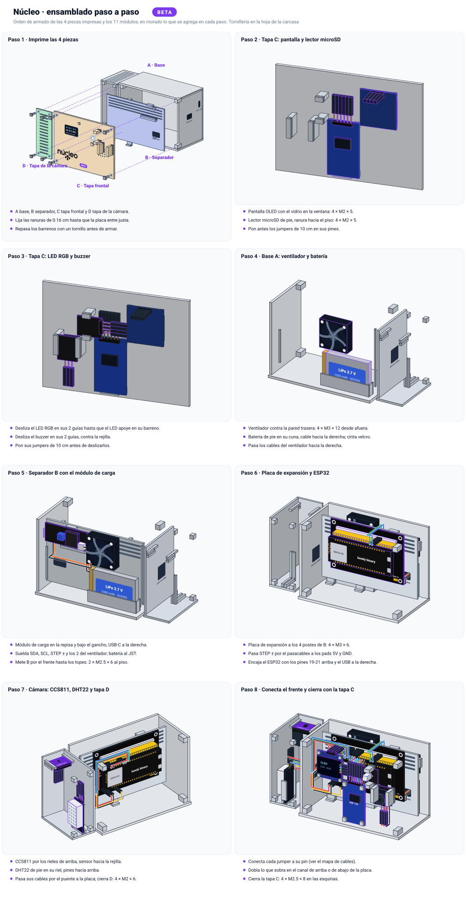
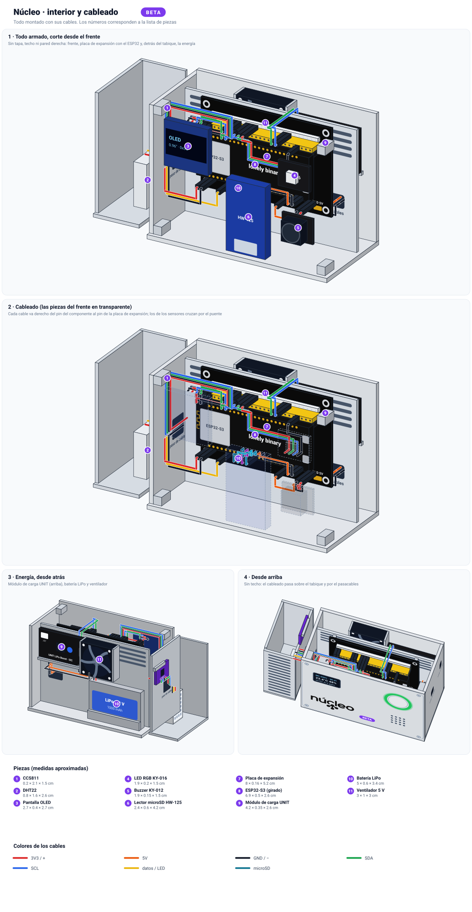
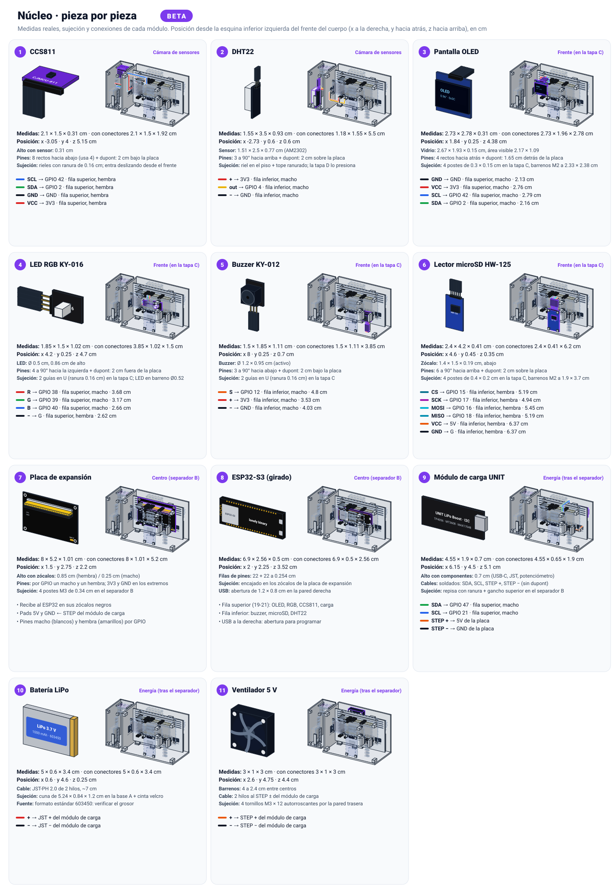
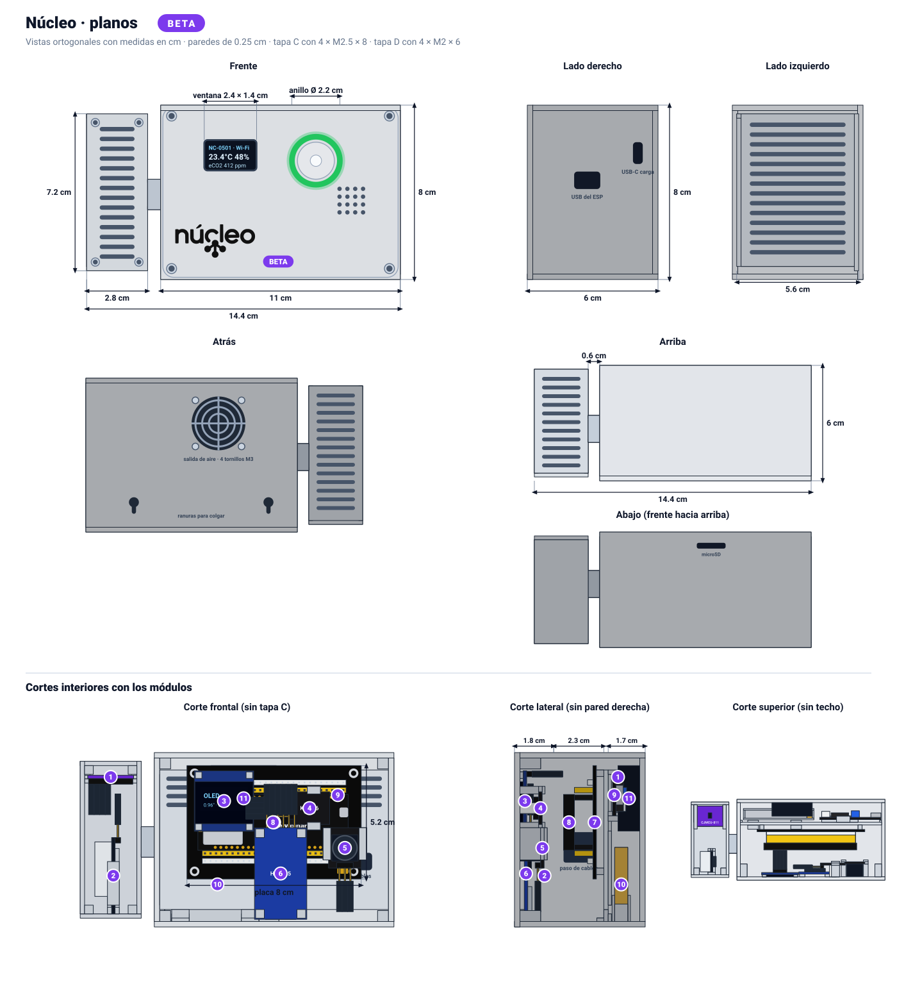

# Núcleo en 3D (beta)

Referencia para modelar, imprimir y renderizar la carcasa de Núcleo. Todas las hojas salen del
mismo modelo, con las **medidas reales de cada módulo** (placa, componentes, pines y conectores
dupont), así que medidas, posiciones y cables coinciden entre sí. Las medidas van en
**centímetros**, desde la esquina inferior izquierda del frente del cuerpo (x a la derecha, y
hacia atrás, z hacia arriba). Las que dicen «verificar» son de la ficha de la tienda o de la foto:
mide tu módulo antes de imprimir.



## Hojas

| Hoja | Qué muestra |
| --- | --- |
| [Exterior](exterior.svg) | Cuatro perspectivas con las medidas generales |
| [Carcasa en 4 piezas](esqueleto.svg) | Base, separador y las dos tapas, cada una con sus soportes rotulados y medidos; explotada con tornillos; tablas de medidas y tornillería |
| [Medidas de cada módulo](medidas.svg) | Cada módulo de frente y de lado con cotas, su ficha (placa, pines, sujeción, fuente) y su posición |
| [Ensamblado paso a paso](ensamblado.svg) | Los 8 pasos de armado; en morado lo que se agrega en cada uno |
| [Interior y cableado](interior.svg) | Todo montado con cables y conectores: corte desde el frente, frente transparente, energía y desde arriba |
| [Mapa de cables](cableado.svg) | Vistas planas del cableado con el nombre de cada pin y las capas de fondo medidas |
| [Pieza por pieza](piezas.svg) | Una tarjeta por módulo: medidas, posición, sujeción y a qué pin va cada cable |
| [Planos](planos.svg) | Vistas ortogonales con medidas y cortes interiores |

### Exterior


### Carcasa en 4 piezas


### Medidas de cada módulo



### Ensamblado paso a paso



### Interior y cableado



### Mapa de cables


### Pieza por pieza



### Planos



## Piezas impresas

Son 4. Las tapas cierran con tornillos pequeños en las esquinas, que roscan en postes de la base.

| Pieza | Nombre | Envolvente x × y × z (cm) | Qué lleva |
| --- | --- | --- | --- |
| A | Base | 14.4 × 6 × 8 | cuerpo, cámara de sensores, puente de cables, postes de las tapas, cuna de la batería, rieles del CCS811 y del DHT22, topes del separador |
| B | Separador | 10.5 × 0.99 × 6.95 | tabique con rejilla y pasacables, 4 postes M3 de la placa de expansión, repisa y gancho del módulo de carga, 2 patas al piso |
| C | Tapa frontal | 11 × 1.5 × 8 | ventana de la pantalla, barreno del LED RGB con chaflán, rejilla del buzzer, postes de la pantalla y del lector microSD, guías del LED RGB y del buzzer |
| D | Tapa de la cámara | 2.8 × 0.38 × 7.2 | rejilla y pestaña que sujeta al DHT22 |

- **Paredes:** cuerpo 0.25 cm, cámara 0.2 cm, separador 0.2 cm.
- **Ranuras para placas:** 0.16 cm para placas de 0.16 cm; si tu impresora cierra los huecos,
  súbelas a 0.19 cm.
- **Barrenos:** para rosca directa en el plástico M2 Ø 0.16, M2.5 Ø 0.21, M3 Ø 0.25 cm; pasantes
  M2 Ø 0.24, M2.5 Ø 0.29, M3 Ø 0.34 cm.
- **Impresión sugerida:** PETG o PLA, capa de 0.2 mm, 3 perímetros; las tapas acostadas por su cara
  exterior y la base de pie sobre el piso.

### Tornillería

| Cantidad | Medida | Dónde |
| --- | --- | --- |
| 4 | M2.5 × 8 | tapa C → postes de las esquinas de la base A |
| 4 | M2 × 6 | tapa D → postes de las esquinas de la cámara (base A) |
| 2 | M2.5 × 6 | pestañas del separador B → piso de la base A |
| 4 | M3 × 6 | placa de expansión → postes del separador B |
| 4 | M2 × 5 | pantalla OLED → postes de la tapa C |
| 4 | M2 × 5 | lector microSD → postes de la tapa C |
| 4 | M3 × 12 | ventilador → desde afuera, por la pared trasera de la base A |

## Cómo está armado

- **El ESP32 va acostado y girado:** antena hacia la cámara de sensores (izquierda), USB a la
  derecha y la fila de los pines **19, 20 y 21 arriba**. Cada módulo queda del lado de los pines
  que usa, igual que en el prototipo:
  - **Arriba (lado 19-21):** pantalla OLED, LED RGB, CCS811 y módulo de carga.
  - **Abajo (lado contrario):** buzzer, lector microSD y DHT22.
- **Cuerpo:** 11 × 6 × 8 cm. **Cámara de sensores:** 2.8 × 5.6 × 7.2 cm
  a la izquierda, separada 0.6 cm para que no le llegue el calor, unida solo por el **puente
  de cables**. El **CCS811 va arriba** (placa acostada en dos rieles, sensor hacia la rejilla
  superior) y el **DHT22 abajo** (de pie en su riel, pines hacia arriba): el calor del CCS811 sube
  y no llega al DHT22.
- **Capas de fondo**, de adelante hacia atrás:
  1. **Tapa C y frente** (0–1.36 cm): la pantalla atornillada contra la ventana, el LED RGB
     apoyado detrás de un barreno de 0.52 cm con chaflán (sin difusor ni acrílico), el lector
     microSD atornillado con la ranura de la tarjeta hacia el piso, y el LED RGB y el buzzer
     deslizados en sus guías.
  2. **Cables y conectores** (1.7–3.6 cm): plano de cables a 1.7 cm del frente,
     conectores dupont (0.25 × 0.25 × 1.4 cm) y el ESP32.
  3. **Placa de expansión** atornillada a 4 postes del **separador B** (a 4.1 cm del frente).
     Cada GPIO tiene un pin macho y uno hembra, con 3V3 y GND en los extremos: la pantalla y el
     CCS811 comparten el bus I2C sin empalmes.
  4. **Energía** (detrás del separador): el **módulo de carga UNIT** en la repisa del separador
     con el USB-C por la pared derecha; la **batería LiPo** de pie en su cuna; el **ventilador de
     3 cm** atornillado a la pared trasera y conectado a la salida STEP del módulo.
- **Jumpers cortos:** la pantalla, el LED RGB, el lector microSD y el buzzer usan jumpers dupont
  de 10 cm. Ningún recorrido pasa de 6.5 cm; lo que sobra se dobla arriba o abajo de la
  placa de expansión.
- Solo lleva los módulos del prototipo armado: sin LED de Wi-Fi, sin MOSFET (el ventilador gira
  siempre que hay 5 V) y sin interruptor aparte (la batería va en el JST del módulo de carga).

## Ensamblado

1. Imprime A, B, C y D; lija las ranuras y repasa los barrenos con un tornillo.
2. **Tapa C:** pantalla con el vidrio en la ventana (4 × M2 × 5) y lector microSD de pie
   (4 × M2 × 5), con sus jumpers ya puestos.
3. **Tapa C:** desliza el LED RGB en sus guías hasta que la punta del LED apoye en su barreno
   (sin difusor: la luz sale directo por el agujero) y el buzzer en las suyas, con sus jumpers puestos.
4. **Base A:** ventilador contra la pared trasera (4 × M3 × 12 desde afuera) y batería en su cuna
   con cinta velcro.
5. **Separador B:** módulo de carga en la repisa; suelda SDA, SCL, STEP ± y el ventilador, y
   conecta la batería al JST. Mete B por el frente hasta los topes (2 × M2.5 × 6 al piso).
6. Placa de expansión a los postes de B (4 × M3 × 6); STEP ± por el pasacables a los pads 5V y
   GND; encaja el ESP32 con los pines 19-21 arriba.
7. **Cámara:** CCS811 por sus rieles, DHT22 en su riel, sus cables por el puente; cierra la tapa D
   (4 × M2 × 6).
8. Conecta los jumpers del frente (ver el mapa de cables) y cierra la tapa C (4 × M2.5 × 8).

## Módulos

Medidas del módulo sin cables. Posición: esquina inferior izquierda delantera, con conectores.

| # | Módulo | Zona | Medidas x × y × z (cm) | Posición x · y · z (cm) | Sujeción |
| --- | --- | --- | --- | --- | --- |
| 1 | CCS811 | Cámara de sensores | 2.1 × 1.5 × 0.31 | -3.05 · 4 · 5.15 | rieles con ranura de 0.16 cm; entra deslizando desde el frente |
| 2 | DHT22 | Cámara de sensores | 1.55 × 3.5 × 0.93 | -2.73 · 0.6 · 0.6 | riel en el piso + tope ranurado; la tapa D lo presiona |
| 3 | Pantalla OLED | Frente (tapa C) | 2.73 × 2.78 × 0.31 | 1.84 · 0.25 · 4.38 | 4 postes de 0.3 × 0.15 cm en la tapa C, barrenos M2 a 2.33 × 2.38 cm |
| 4 | LED RGB KY-016 | Frente (tapa C) | 1.85 × 1.5 × 1.02 | 4.2 · 0.25 · 4.7 | 2 guías en U (ranura 0.16 cm) en la tapa C; LED en barreno Ø 0.52 con chaflán |
| 5 | Buzzer KY-012 | Frente (tapa C) | 1.5 × 1.85 × 1.11 | 8 · 0.25 · 0.7 | 2 guías en U (ranura 0.16 cm) en la tapa C |
| 6 | Lector microSD HW-125 | Frente (tapa C) | 2.4 × 4.2 × 0.41 | 4.6 · 0.45 · 0.35 | 4 postes de 0.4 × 0.2 cm en la tapa C, barrenos M2 a 1.9 × 3.7 cm |
| 7 | Placa de expansión | Centro (separador B) | 8 × 5.2 × 1.01 | 1.5 · 2.75 · 2.2 | 4 postes M3 de 0.34 cm en el separador B |
| 8 | ESP32-S3 (girado) | Centro (separador B) | 6.9 × 2.56 × 0.5 | 2 · 2.25 · 3.52 | encajado en los zócalos de la placa de expansión |
| 9 | Módulo de carga UNIT | Energía | 4.55 × 1.9 × 0.7 | 6.15 · 4.5 · 5.1 | repisa con ranura + gancho superior en el separador B |
| 10 | Batería LiPo | Energía | 5 × 0.6 × 3.4 | 0.6 · 4.6 · 0.25 | cuna de 5.24 × 0.84 × 1.2 cm en la base A + cinta velcro |
| 11 | Ventilador 5 V | Energía | 3 × 1 × 3 | 2.6 · 4.75 · 4.4 | 4 tornillos M3 × 12 autorroscantes por la pared trasera |

## Cables

32 cables. El generador revisa que:

- **Nada se encime:** módulos, conectores dupont, soportes y paredes no ocupan el mismo espacio.
- **Continuidad:** cada cable sale del conector de su módulo y llega a su pin, sin cortes.
- **Sin choques:** ningún cable atraviesa un módulo, un soporte ni una pared; solo cruzan por el
  puente, el pasacables o por encima del separador.
- **Sin cruces:** ningún cable se cruza con los de otro módulo en el plano de cables del frente.
- **Los jumpers de 10 cm alcanzan:** recorrido de 6.5 cm como máximo.

En la placa de expansión llegan con conector dupont: hembra en los pines macho y macho en los
pines hembra. Los cables del módulo de carga van soldados. El largo de los demás ya incluye 3 cm
de holgura.

| Módulo | Pin | Va a | Pasa por | Cable |
| --- | --- | --- | --- | --- |
| DHT22 | + | **3V3** (placa de expansión, fila inferior, pin macho) | puente de cables | 14 cm |
| DHT22 | out | **GPIO 4** (placa de expansión, fila inferior, pin macho) | puente de cables | 15 cm |
| DHT22 | − | **GND** (placa de expansión, fila inferior, pin macho) | puente de cables | 15 cm |
| CCS811 | SCL | **GPIO 42** (placa de expansión, fila superior, pin hembra) | puente de cables | 19 cm |
| CCS811 | SDA | **GPIO 2** (placa de expansión, fila superior, pin hembra) | puente de cables | 18 cm |
| CCS811 | GND | **GND** (placa de expansión, fila superior, pin hembra) | puente de cables | 20 cm |
| CCS811 | VCC | **3V3** (placa de expansión, fila superior, pin hembra) | puente de cables | 20 cm |
| Pantalla OLED | GND | **GND** (placa de expansión, fila superior, pin macho) | directo | jumper de 10 cm (recorrido 2.13 cm) |
| Pantalla OLED | VCC | **3V3** (placa de expansión, fila superior, pin macho) | directo | jumper de 10 cm (recorrido 2.76 cm) |
| Pantalla OLED | SCL | **GPIO 42** (placa de expansión, fila superior, pin macho) | directo | jumper de 10 cm (recorrido 2.79 cm) |
| Pantalla OLED | SDA | **GPIO 2** (placa de expansión, fila superior, pin macho) | directo | jumper de 10 cm (recorrido 2.16 cm) |
| LED RGB KY-016 | R | **GPIO 38** (placa de expansión, fila superior, pin macho) | directo | jumper de 10 cm (recorrido 3.68 cm) |
| LED RGB KY-016 | G | **GPIO 39** (placa de expansión, fila superior, pin macho) | directo | jumper de 10 cm (recorrido 3.17 cm) |
| LED RGB KY-016 | B | **GPIO 40** (placa de expansión, fila superior, pin macho) | directo | jumper de 10 cm (recorrido 2.66 cm) |
| LED RGB KY-016 | − | **G** (placa de expansión, fila superior, pin hembra) | directo | jumper de 10 cm (recorrido 2.62 cm) |
| Buzzer KY-012 | S | **GPIO 12** (placa de expansión, fila inferior, pin macho) | directo | jumper de 10 cm (recorrido 4.8 cm) |
| Buzzer KY-012 | + | **3V3** (placa de expansión, fila inferior, pin macho) | directo | jumper de 10 cm (recorrido 3.53 cm) |
| Buzzer KY-012 | − | **GND** (placa de expansión, fila inferior, pin macho) | directo | jumper de 10 cm (recorrido 4.03 cm) |
| Lector microSD HW-125 | CS | **GPIO 15** (placa de expansión, fila inferior, pin hembra) | directo | jumper de 10 cm (recorrido 5.19 cm) |
| Lector microSD HW-125 | SCK | **GPIO 17** (placa de expansión, fila inferior, pin hembra) | directo | jumper de 10 cm (recorrido 4.94 cm) |
| Lector microSD HW-125 | MOSI | **GPIO 16** (placa de expansión, fila inferior, pin hembra) | directo | jumper de 10 cm (recorrido 5.45 cm) |
| Lector microSD HW-125 | MISO | **GPIO 18** (placa de expansión, fila inferior, pin hembra) | directo | jumper de 10 cm (recorrido 5.19 cm) |
| Lector microSD HW-125 | VCC | **5V** (placa de expansión, fila inferior, pin hembra) | directo | jumper de 10 cm (recorrido 6.37 cm) |
| Lector microSD HW-125 | GND | **G** (placa de expansión, fila inferior, pin hembra) | directo | jumper de 10 cm (recorrido 6.37 cm) |
| Módulo de carga UNIT | SDA | **GPIO 47** (placa de expansión, fila superior, pin macho) | sobre el separador | 8 cm |
| Módulo de carga UNIT | SCL | **GPIO 21** (placa de expansión, fila superior, pin macho) | sobre el separador | 8 cm |
| Módulo de carga UNIT | STEP + | 5V de la placa | pasacables del separador | 8 cm |
| Módulo de carga UNIT | STEP − | GND de la placa | pasacables del separador | 8 cm |
| Ventilador 5 V | + | STEP + del módulo de carga | directo | 9 cm |
| Ventilador 5 V | − | STEP − del módulo de carga | directo | 10 cm |
| Batería LiPo | + | JST + del módulo de carga | directo | 6 cm |
| Batería LiPo | − | JST − del módulo de carga | directo | 6 cm |

- El CCS811 lleva su pin **WAK** puenteado a GND en el propio módulo.
- La salida **STEP** del módulo de carga se ajusta a **5.0 V** (switch STEP UP en ON) antes de
  conectarla a la placa de expansión; ver [Conexiones del ESP32](../../Context/iot/conexiones.md#batería).

## Generador

Las hojas y este README salen de `generador/` (Python 3, sin dependencias):

```bash
cd Docs/nucleo3d/generador
python3 verificar.py   # encimados, continuidad, choques, cruces y largo de los jumpers
python3 render2.py     # las 9 hojas SVG
python3 readme.py      # este README
```

Las medidas de los módulos, los soportes y las 4 piezas impresas están en `modelo2.py`.
