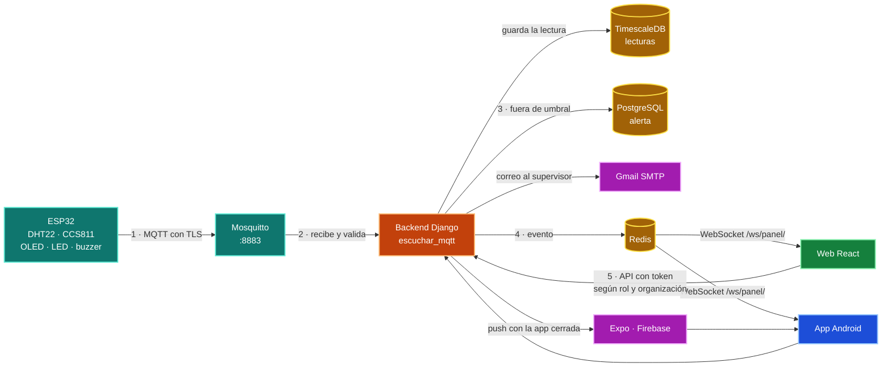
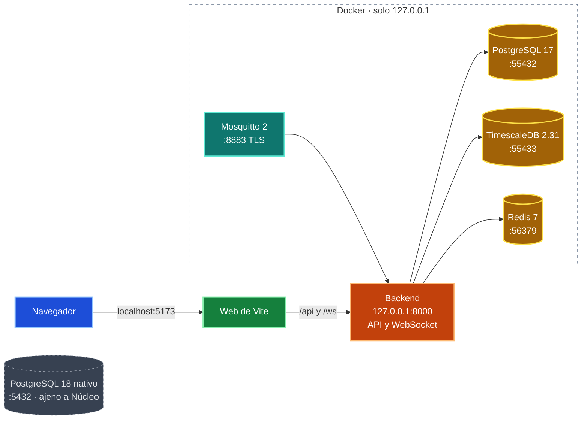
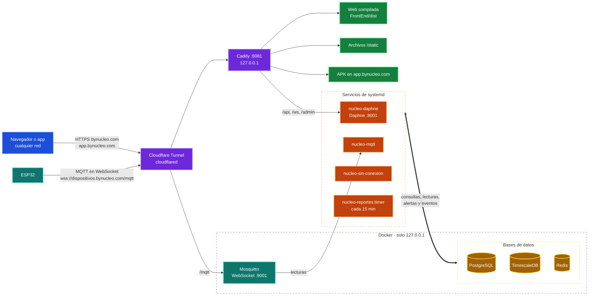
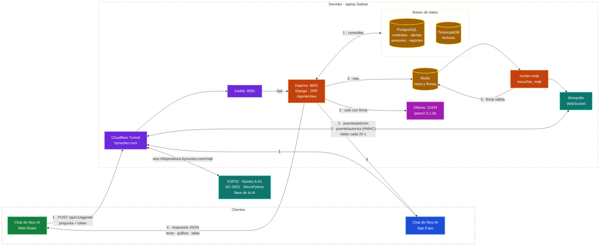
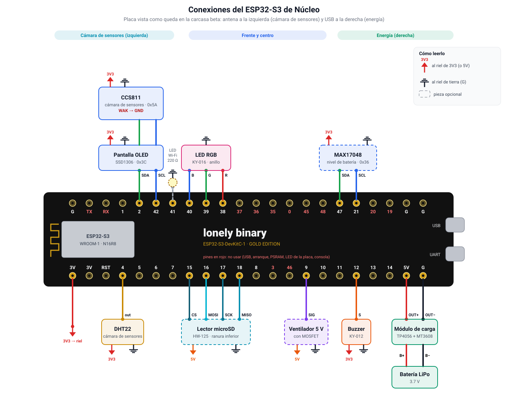
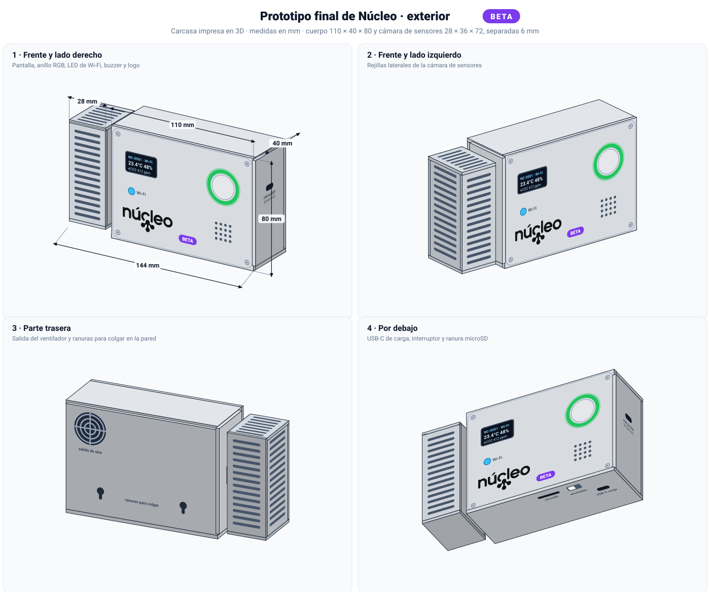
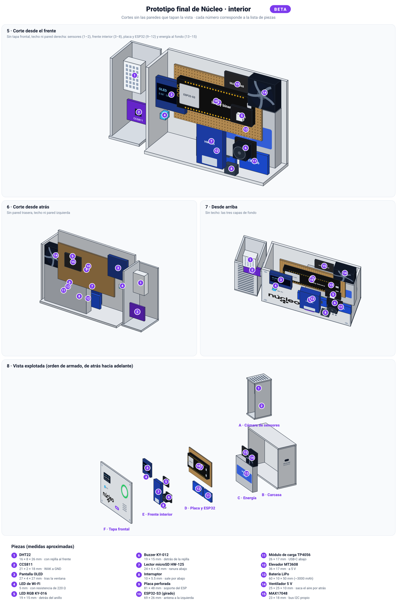
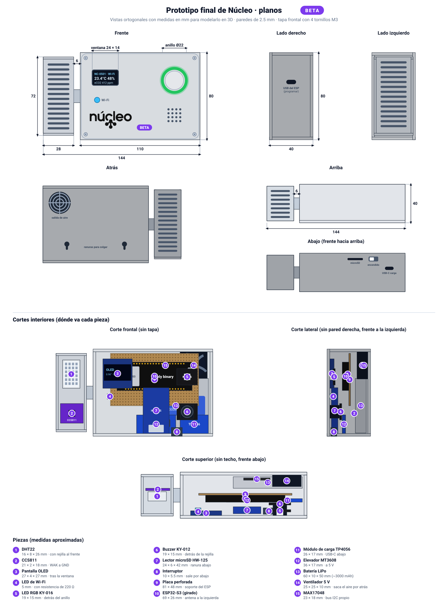

# Núcleo — Gestión y monitoreo del ambiente

Hoy todo el sistema funciona y está publicado: el backend, el modelo de datos, el broker,
el canal en vivo, la web con todas sus pantallas y la app Android (APK) con notificaciones
push. El firmware del ESP32 está escrito y probado en su lógica; falta probarlo en la placa
con los sensores, así que por ahora las lecturas vienen del simulador.

## Qué funciona

- **Backend**
  - Inicio de sesión con token (caduca a los 7 días sin uso, máximo 10 intentos por
    minuto), permisos por rol y aislamiento por organización.
  - API de organizaciones, áreas, usuarios, dispositivos, sensores, umbrales, lecturas,
    alertas, notificaciones y reportes.
  - Recibe las lecturas por MQTT, crea alertas de advertencia o peligro, avisa por correo
    y por push, y transmite en vivo por WebSocket las alertas y los cambios de estado.
  - Reportes con cifras, gráficas y PDF, manuales o programados por correo; el texto se
    redacta a partir de las cifras (`IA_PROVEEDOR=local`).
  - **Nico AI:** un agente por dispositivo que responde con sus lecturas y alertas, y
    genera reportes cuando se le piden («reporte de octubre», «de la semana pasada»); el
    resumen y el PDF se ven en el mismo chat de la web y de la app.
- **Web**
  - Panel en vivo, Dispositivos (con estado, batería, señal y «Calentando»), Detalle de
    dispositivo, Histórico, Alertas (atender o descartar), Reportes, Nico AI, Umbrales,
    Usuarios, Empresa y áreas, Mi perfil y Notificaciones, con tema claro u oscuro.
  - **Organizaciones**, solo para el administrador de plataforma: alta, edición,
    suspensión, baja y primer administrador de cada empresa cliente.
- **App móvil (Android)**
  - Inicio con el dispositivo en vivo (selector si hay varios), Detalle de variable,
    Alertas y su detalle, Nico AI y Perfil.
  - Canal en vivo con la app abierta y notificaciones push con la app cerrada; las de
    peligro suenan y vibran. Opción para reducir animaciones y preferencias guardadas en el teléfono.
  - Se instala con el APK de https://app.bynucleo.com.
- **IoT**
  - Firmware de MicroPython (`boot.py`, `main.py` y el paquete `nucleo/`) con DHT22,
    CCS811, pantalla OLED, LED RGB, buzzer y MQTT con TLS, cola de lecturas sin conexión y
    baseline del CCS811, con 16 pruebas de su lógica.
  - Falta: cargarlo en un ESP32 real, ajustar los pines y calibrar el CCS811.
- **Broker MQTT**
  - Mosquitto con TLS en el puerto 8883, un usuario por dispositivo y permisos que lo
    limitan a su propio tópico.
- **Base de datos**
  - PostgreSQL con las 16 tablas del modelo relacional, TimescaleDB con la hypertable de
    lecturas, Redis para el canal en vivo y scripts de práctica para cada base. Cada base
    corre en su propio contenedor con su propio usuario.
- **Documentación**
  - READMEs por stack, `Context/` técnico completo y, en `Docs/`, el SRS, el modelo
    relacional y los documentos de planificación y análisis.

## Cómo funciona



1. El ESP32 lee el DHT22 y el CCS811, muestra los datos en la pantalla OLED, enciende
   el LED RGB y el buzzer según los umbrales y publica las mediciones por MQTT con TLS.
2. El backend las recibe del broker, las valida y las guarda en TimescaleDB.
3. Si una lectura sale de los límites de advertencia o de peligro de su dispositivo,
   crea la alerta en PostgreSQL y avisa por correo al supervisor del área.
4. El backend publica la alerta y los cambios de estado en Redis y llegan por WebSocket a
   la web y la app. Con la app cerrada, la alerta llega al teléfono por push (Expo y
   Firebase).
5. La web y la app móvil piden los datos al mismo backend con su token; cada
   persona ve solo lo que su rol y su organización permiten.

Hoy el flujo funciona de punta a punta desde el broker hasta la web y la app; mientras el
ESP32 no se prueba en la placa, `simular_dispositivos` publica lecturas con el mismo
formato que el firmware.

## Stack

```text
Stack
├── Backend          Python 3.12.15 · Django 5.2.18 · Django REST Framework 3.18.3 · Channels 4.3
├── Base de datos    PostgreSQL 17.11 · TimescaleDB 2.31.0 · Redis 7
├── Broker MQTT      Eclipse Mosquitto 2 con TLS
├── Web              React 19.3.1 · Vite 8.3.5 · React Router 7 · npm 11.16.0
├── App móvil        Expo 58.0.23 · React Native 0.88.1 · React Navigation 7 · npm 11.16.0
├── IoT              Python 3.12 · MicroPython 1.29.0 para ESP32 · Pymakr 2.22.5
└── Contenedores     Docker Engine 29.9.2 · Compose 5.6.1
```

Las versiones exactas están fijadas en los `requirements.txt` de backend e IoT y
en los `package-lock.json` de web y móvil.

## Carpetas

```text
Nucleo/
├── BackEnd/               Django, API compartida, pruebas y README
├── FrontEnd/              Web React + Vite y README
├── Mobile/                App Expo + React Native y README
├── IoT/                   MicroPython para ESP32, bibliotecas y README
├── Mosquitto/             Configuración del broker MQTT y scripts de certificados y dispositivos
├── Database/              Scripts .sql de práctica: Web-Mobile (PostgreSQL) e IoT (TimescaleDB),
│                          y crear-roles.sh (opcional)
├── deploy/                Instalación, despliegue, respaldos y APK del servidor
├── Context/               Documentación técnica completa para el equipo y la IA
├── Docs/                  SRS, modelo relacional, planificación y análisis
├── docker-compose.yml     PostgreSQL, TimescaleDB, Redis y Mosquitto en Docker
├── .env.example           Plantilla de configuración, sin secretos
├── .gitignore             Archivos que Git debe ignorar
└── README.md              Este documento
```

Consulta [BackEnd](BackEnd/README.md), [Web](FrontEnd/README.md),
[Mobile](Mobile/README.md), [IoT](IoT/README.md) y
[Base de datos](Database/README.md) para los comandos de cada parte.

## Antes de empezar

Necesitas Python 3.12, Node.js 22 o superior, npm, Docker con Compose, Git y
VS Code con la extensión Pymakr. Las herramientas del ESP32 se instalan dentro
de `IoT/.venv`.

- `cp .env.example .env` — "crea la configuración principal; después completa las contraseñas de PostgreSQL y TimescaleDB."
- `openssl rand -hex 24` — "genera cada contraseña (bases de datos, Redis y broker)."
- `chmod 600 .env` — "protege el archivo para que solo lo lea su dueño."
- `cp BackEnd/.env.example BackEnd/.env` — "crea la configuración de Django; completa `DJANGO_SECRET_KEY` y la contraseña de `DATABASE_URL`."
- `python3.12 -c "import secrets; print(secrets.token_urlsafe(64))"` — "genera la clave larga de Django."
- `chmod 600 BackEnd/.env` — "protege la configuración del backend."
- `cp FrontEnd/.env.example FrontEnd/.env` — "crea la configuración de la web con la URL de la API."
- `cp Mobile/.env.example Mobile/.env` — "crea la configuración de la app móvil con la URL de la API."

La contraseña de `POSTGRES_PASSWORD` debe ser la misma dentro de
`DATABASE_URL` en `BackEnd/.env`. `IOT_PASSWORD` se usará para TimescaleDB y `REDIS_PASSWORD` para Redis (va también dentro
de `REDIS_URL` en `BackEnd/.env`).
`MQTT_BACKEND_PASSWORD` y `MQTT_DEVICE_PASSWORD` son las contraseñas del broker; la
primera va también como `MQTT_PASSWORD` en `BackEnd/.env`. No subas `.env`,
`secrets.py` ni certificados privados a Git.

## Inicializar

Todos los comandos se ejecutan desde la carpeta principal del proyecto.

**Bases de datos**

- `docker compose up -d --wait postgres timescaledb redis` — "enciende PostgreSQL, TimescaleDB y Redis; termina con los tres contenedores saludables."
- `docker compose ps` — "muestra el estado de los servicios."

**Broker MQTT**

- `bash Mosquitto/preparar.sh` — "crea los certificados de desarrollo y los usuarios `nucleo_backend` y `NUC-001`; usa las contraseñas de `.env`."
- `bash Mosquitto/dispositivo.sh NUC-002` — "crea el usuario MQTT de otro dispositivo; imprime su contraseña una sola vez."
- `docker compose up -d --wait mosquitto` — "enciende Mosquitto con TLS en el puerto 8883."

**Backend**

- `python3.12 -m venv BackEnd/.venv` — "crea el entorno aislado de Python."
- `BackEnd/.venv/bin/pip install --upgrade pip` — "actualiza el instalador."
- `BackEnd/.venv/bin/pip install -r BackEnd/requirements-dev.txt` — "instala Django, DRF, el cliente MQTT, ReportLab y las herramientas."
- `cd BackEnd && .venv/bin/python manage.py migrate` — "crea las 16 tablas de `nucleo_db` y carga los catálogos."
- `cd BackEnd && .venv/bin/python manage.py migrate --database=iot` — "crea la hypertable `lectura` en `nucleo_iot`."
- `cd BackEnd && .venv/bin/python manage.py sembrar_demo` — "crea dos organizaciones con áreas, usuarios de cada rol, 17 dispositivos, 14 días de lecturas, alertas y reportes; todas las cuentas usan la contraseña `Nucleo2026`."
- `cd BackEnd && .venv/bin/python manage.py sembrar_demo --reiniciar` — "borra los datos (menos los catálogos) y siembra de nuevo."
- `cd BackEnd && .venv/bin/python manage.py simular_dispositivos` — "simula los ESP32 en servicio: manda lecturas a su intervalo y genera alertas y eventos en vivo; se detiene con `Ctrl+C`."
- `cd BackEnd && .venv/bin/python manage.py escuchar_mqtt` — "recibe las lecturas del broker; se deja en otra terminal y se detiene con `Ctrl+C`."
- `cd BackEnd && .venv/bin/python manage.py runserver 0.0.0.0:8000` — "abre la API y el canal en vivo en `http://127.0.0.1:8000`; se detiene con `Ctrl+C`."

**Web**

- `cd FrontEnd && npm ci` — "instala las versiones exactas de React y Vite."
- `cd FrontEnd && npm run dev` — "abre la web en `http://localhost:5173`; se detiene con `Ctrl+C`."

**App móvil**

- `cd Mobile && npm ci` — "instala Expo y React Native."
- `cd Mobile && npm start` — "abre Expo y muestra un código QR; se detiene con `Ctrl+C`."
- `cd Mobile && npm run android` — "abre la app en un emulador Android."

Las notificaciones push solo llegan en el APK compilado (`deploy/compilar_apk.sh`), con
`Mobile/google-services.json` (fuera de git); en Expo Go o en el emulador se prueban con la
app abierta por el canal en vivo.

**IoT**

- `python3.12 -m venv IoT/.venv` — "crea el entorno de herramientas del ESP32."
- `IoT/.venv/bin/pip install --upgrade pip` — "actualiza el instalador."
- `IoT/.venv/bin/pip install -r IoT/requirements.txt` — "instala `esptool`, `mpremote` y el autocompletado de MicroPython."
- `code --install-extension pycom.pymakr` — "instala Pymakr en VS Code."

Grabar MicroPython en la placa, copiar las bibliotecas y usar Pymakr está
explicado paso a paso en [IoT/README.md](IoT/README.md).

Abre el backend, la web y la app móvil en terminales separadas. PostgreSQL y
TimescaleDB pueden quedar encendidos o apagarse sin perder datos.

## Mantenimiento

- `docker compose down` — "apaga PostgreSQL; conserva el volumen y los datos."
- `docker compose logs -f --tail=100 postgres timescaledb` — "muestra los mensajes en vivo; se corta con `Ctrl+C`."
- `docker compose config --quiet` — "revisa la receta de Docker; no muestra nada si está bien."

## Base de datos de prueba

`Database/` tiene una carpeta por base: `Web-Mobile/` con las 16 tablas y una base
aparte, `nucleo_test`, y `IoT/` con la hypertable de lecturas y `nucleo_iot_test`, para
practicar tablas, consultas, procedimientos y triggers sin tocar las bases reales. No usa
archivos `.db`: PostgreSQL no trabaja con ese formato. Los comandos `docker exec` están en
[Database/README.md](Database/README.md).

## Comprobaciones

- `cd BackEnd && .venv/bin/python manage.py check` — "revisa Django; muestra `System check identified no issues`."
- `cd BackEnd && .venv/bin/python manage.py test` — "ejecuta las pruebas; muestra `Ran 147 tests` y `OK`."
- `cd BackEnd && .venv/bin/ruff check .` — "revisa el estilo; muestra `All checks passed!`."
- `cd FrontEnd && npm run lint` — "revisa la web; no muestra avisos si todo está bien."
- `cd FrontEnd && npm run build` — "genera `FrontEnd/dist/`; Vite muestra `built in ...`."
- `cd Mobile && npm run lint` — "revisa la app móvil; no muestra avisos si todo está bien."
- `cd Mobile && npm run export:android` — "genera el bundle de Android; no crea un APK."
- `IoT/.venv/bin/python -m unittest discover -s IoT/tests -t IoT` — "ejecuta las 16 pruebas de la lógica del firmware; muestra `OK`."
- `IoT/.venv/bin/mpremote devs` — "lista las placas conectadas por USB; el ESP32 aparece con su puerto."
- `docker compose config --quiet` — "valida Docker Compose."

Para ver la API:

- `curl http://127.0.0.1:8000/api/v1/health/` — "muestra un JSON con `status: ok` si el backend está activo."

## Servicios



## Documentación

- [Contexto técnico](Context/README.md): arquitectura, instalación, base de
  datos, firmware y decisiones.
- [Contrato de la API](Context/api/contrato-api.md): lo que comparten web y móvil.
- [Modelo relacional](Context/base-de-datos/modelo-relacional.md): las 16 tablas y la hypertable de lecturas.
- [Broker MQTT](Context/mqtt/broker-mosquitto.md): tópicos, mensajes y permisos.
- [Verificación inicial](Context/reportes/verificacion-inicial.md): comandos y
  resultados reales.
- [Informe de avance](Docs/informe-2026-10-24-nucleo.pdf): mapa de carpetas y archivos,
  guía de integración y pendientes del SRS.

La carpeta `Docs/` reúne el SRS, el modelo relacional y los documentos de
planificación y análisis, además de los reportes formales de avance, seguridad y
evidencias que se agreguen.

## Control de versiones

**Ramas**

```text
main       Solo entregas estables, con un tag por etapa
dev        Integración; siempre debe funcionar
backend    Trabajo del backend (BackEnd/)
frontend   Trabajo de la web (FrontEnd/)
mobile     Trabajo de la app móvil (Mobile/)
iot        Trabajo del firmware y del broker (IoT/ y Mosquitto/)
```

- Cada área trabaja solo en su rama: así dos áreas no editan los mismos archivos a la vez.
- La documentación (`Context/`, `Docs/`, READMEs) y `Database/` no tienen rama propia: viajan
  con la rama del área que las modifica. Un cambio que toca varias áreas se coordina en `dev`.
- Para evitar conflictos al integrar, se trae `dev` a la rama del área con frecuencia
  (`git merge dev`) y se suben cambios pequeños.
- Si dos personas trabajan a la vez dentro de una misma área, cada una usa una rama corta
  (`feature/<tarea>` o `fix/<tarea>`) que sale de la rama del área y vuelve a ella.
- Cada área se integra a `dev` con un pull request y las pruebas pasando.
- `dev` pasa a `main` solo al cerrar una etapa; esa versión lleva un tag con el nombre de la
  etapa (por ejemplo `etapa-1` o `v0.1.0`).
- Nadie trabaja directo sobre `main` ni sobre `dev`.

**Commits**

Un commit es un solo cambio lógico, con un mensaje de **una línea** con la forma
`tipo(alcance): resumen`:

- **Tipo:** `feat` (funcionalidad nueva), `fix` (corrección), `docs` (solo documentación),
  `test` (pruebas), `refactor` (reorganiza sin cambiar el comportamiento), `perf` (rendimiento),
  `style` (formato sin cambiar el código), `chore` (dependencias, configuración, tareas
  menores) y `revert` (deshace un commit).
- **Alcance** (opcional): `backend`, `web`, `mobile`, `iot`, `mosquitto`, `db` o el nombre de
  una app como `alertas`.
- **Resumen:** en español, con el verbo en presente (`agrega`, `corrige`, `elimina`), sin punto
  final y de máximo 72 caracteres.
- **Cuerpo:** solo si el porqué no es evidente; va separado por una línea en blanco y no
  repite lo que ya muestra el cambio.
- **Cambio que rompe compatibilidad:** se marca con `!` (por ejemplo `feat(backend)!:`) y
  se explica en el cuerpo.
- No se agregan coautores ni etiquetas automáticas de herramientas: el commit va a nombre de
  quien lo hizo.

Cuál usar según la situación:

- `feat(backend): agrega serie de lecturas por hora` — "agregaste una función."
- `fix(iot): reenvía las lecturas encoladas al reconectar` — "arreglaste un error."
- `docs: actualiza la guía de instalación` — "cambiaste solo documentación."
- `test(backend): cubre la caducidad del token` — "agregaste o ajustaste pruebas."
- `refactor(web): mueve el cliente HTTP a services/api` — "reorganizaste código sin cambiar su comportamiento."
- `chore(mobile): actualiza expo a 58.0.19` — "actualizaste dependencias."
- `chore(mosquitto): limita cada usuario a su tópico` — "cambiaste configuración."
- `revert: deshace "feat(backend): agrega serie por hora"` — "deshiciste un commit."

Se evita: `cambios`, `varios arreglos`, listas de archivos o párrafos que repiten el cambio.
Si un commit necesita muchas líneas para explicarse, probablemente son varios commits.

## Seguridad

- Los `.env` y `secrets.py` no se versionan.
- PostgreSQL, TimescaleDB, Redis y Mosquitto solo escuchan en `127.0.0.1`.
- El broker exige TLS y usuario; cada dispositivo solo publica en su propio tópico.
- La API exige token (caduca a los 7 días sin uso) y limita cada respuesta a la organización y al rol del usuario.
- Las contraseñas de los usuarios se guardan cifradas.
- No se deben guardar contraseñas ni claves en el código.

## Servidor

| Dirección | Para qué |
| --- | --- |
| **https://bynucleo.com** | Web, API de la app (`/api/v1`), panel en vivo y admin |
| **https://app.bynucleo.com** | Descarga de la app Android |
| `dispositivos.bynucleo.com` | Solo para los ESP32: MQTT (dentro de WebSocket) y llave de Nico AI |

Todo llega por un Cloudflare Tunnel, sin abrir puertos en el router. Abrir `dispositivos.` en el
navegador lleva a `bynucleo.com`. Corre en un servidor propio: una
laptop ASUS X75A con Debian 13 sin escritorio (procesador Intel Core i5-3230M de 2 núcleos y 4 hilos a
2.6 GHz, 8 GB de RAM y disco duro mecánico HDD de 750 GB, 698 GB utilizables) que funciona como VPS casero.

**Cómo llega una visita**



- **Dominio:** `bynucleo.com` está en Cloudflare; el túnel `nucleo` (servicio `cloudflared`)
  lleva las visitas a Caddy sin abrir puertos en el router. `http://` y `www.` redirigen a
  `https://bynucleo.com`; `app.bynucleo.com` entrega el APK.
- **Subdominio de los ESP32:** Cloudflare solo deja pasar HTTPS, así que los ESP32 hablan MQTT
  dentro de WebSocket en `wss://dispositivos.bynucleo.com/mqtt`; el túnel lo lleva directo al
  listener WebSocket de Mosquitto (solo local). El ESP valida el certificado con las raíces de
  Let's Encrypt y Google que lleva el firmware. En ese subdominio solo quedan además el respaldo
  HTTPS de Nico y la hora (`/api/v1/puente/`, `/api/v1/health/`).
- **Web:** Vite la compila contra la API real y Caddy la sirve como archivos estáticos.
- **API y tiempo real:** Daphne atiende HTTP y WebSocket (`/ws/panel/`) como servicio
  `nucleo-daphne`; Redis reparte los eventos en vivo.
- **Lecturas:** `nucleo-mqtt` recibe las lecturas del broker Mosquitto y las guarda en
  TimescaleDB; `nucleo-sin-conexion` marca los dispositivos que dejan de reportar.
- **Reportes:** `nucleo-reportes.timer` genera cada 15 minutos los reportes programados, con el
  texto redactado por `IA_PROVEEDOR=local`.
- **Correo:** Gmail por SMTP con una contraseña de aplicación de la cuenta del proyecto.
- **Push:** `NUCLEO_PUSH_HABILITADO=true`; el backend envía a Expo, que entrega por Firebase
  (proyecto `nucleo-firebase`) a los teléfonos registrados al iniciar sesión en la app.
- **App:** `deploy/compilar_apk.sh` compila el APK en el mismo servidor y lo publica en
  `https://app.bynucleo.com`.
- **Respaldos:** `nucleo-respaldo.timer` respalda a diario las dos bases y la configuración del
  broker: 7 días en el servidor y 30 en Google Drive.
- **Disponibilidad:** todos los servicios arrancan con el equipo y se reinician solos; los
  contenedores tienen límite de memoria. El equipo no se suspende con la tapa
  cerrada ni por inactividad, usa el cable si está conectado y el Wi-Fi como respaldo.

**Actualizar el servidor** después de subir cambios a `dev`: desde el servidor,
`bash deploy/desplegar.sh` (trae `dev`, migra, recompila y reinicia).

El acceso por SSH desde cualquier red, los comandos de operación y la instalación desde cero
están en [`deploy/README.md`](deploy/README.md).

## Nico AI

Agente de cada dispositivo que responde en lenguaje natural sobre sus lecturas, alertas,
sensores, umbrales y reportes. Es de solo lectura y las cifras siempre salen del backend; la IA
solo interpreta y redacta.



1. La web o la app envía la pregunta al backend, que consulta las cifras.
2. Si hace falta la IA, el backend manda un reto al ESP32 de **Núcleo A-01 (NC-0501)** por MQTT.
3. El ESP lo firma con su clave (HMAC-SHA256) y solo con esa firma el backend usa Ollama
   (`qwen2.5:1.5b`, en el mismo servidor).
4. El backend responde al chat.

El ESP manda un latido cada 20 s: sin latido en 75 s, o con su último mensaje al desconectarse,
Nico se desactiva. Solo A-01 usa la IA; los demás dispositivos son simulados y responden sin
ella. Si la firma no llega en 12 s o la IA tarda más de 20 s, el agente contesta solo con las
reglas.

Para validar cambios: `manage.py evaluar_agente --dispositivo NC-0501` corre el banco de casos
(`apps/reportes/casos_agente.py`) sin guardar nada. El detalle está en
[`Context/backend/estructura-backend.md`](Context/backend/estructura-backend.md#agente-ia).

## Conexiones del ESP32

Placa: ESP32-S3-DevKitC-1 N16R8 (Lonely Binary). Los pines se reparten según el
[prototipo beta](#prototipo-final-esperado-beta): la placa va **girada** dentro de la carcasa, con la
antena hacia la cámara de sensores (izquierda) y el USB hacia el compartimento de energía
(derecha). Cada pieza usa los pines del lado donde queda, en las dos filas, así que los cables
salen derechos y no se cruzan. Las alimentaciones se marcan con su símbolo (flecha roja de 3V3,
naranja de 5V y tierra): van a los rieles. Las piezas con borde punteado son opcionales y los
pines en rojo no se usan.



| Zona de la carcasa | Componente | Pines del componente → ESP32-S3 | Fila | Alimentación |
| --- | --- | --- | --- | --- |
| Sensores (izq.) | CCS811 | SDA → **2**, SCL → **42**, WAK → G | superior | VCC → 3V3, GND → G |
| Sensores (izq.) | DHT22 | out → **4** | inferior | + → 3V3, − → G |
| Frente | Pantalla OLED SSD1306 | SDA → **2**, SCL → **42** (en cadena con el CCS811) | superior | VCC → 3V3, GND → G |
| Frente | LED de Wi-Fi (opcional) | ánodo → **41** (con resistencia de 220 Ω) | superior | cátodo → G |
| Frente | LED RGB (KY-016) | B → **40**, G → **39**, R → **38** | superior | − → G |
| Frente | Buzzer (KY-012) | S → **9** | inferior | + → 3V3, − → G |
| Borde inferior | Lector microSD HW-125 (opcional) | CS → **15**, MOSI → **16**, SCK → **17**, MISO → **18** | inferior | VCC → **5V**, GND → G |
| Energía (der.) | MAX17048 (opcional) | SDA → **47**, SCL → **21** (bus propio) | superior | VCC → 3V3, GND → G |
| Energía (der.) | Ventilador 5 V (opcional) | MOSFET SIG → **12** | inferior | + → 5V, − → MOSFET → G |
| Energía (der.) | Módulo de carga | OUT+ → **5V**, OUT− → **G** | inferior | Batería en B+ / B− |
| — | Riel de 3.3 V | sale del pin **3V** | inferior | — |

- **Rieles:** uno de **3V3** (desde el pin 3V), uno de **5V** (desde la salida del módulo de carga)
  y uno de **GND** común. Todos los G del dibujo van al riel GND.
- **Dos buses I2C:** la OLED (0x3C) y el CCS811 (0x5A) en 2/42, del lado de los sensores; el
  MAX17048 (0x36) en su propio bus 47/21, junto a la batería, para no cruzar la carcasa con
  cables. Con `PIN_I2C_BATERIA_SDA = None` vuelve a compartir el primer bus. El CCS811 necesita
  **WAK a GND** o no responde.
- **Módulo de carga:** si es solo un TP4056 (sin salida de 5 V), entre OUT+ y el pin 5V va el
  elevador MT3608 ajustado a 5 V. Nunca conectes la batería directo al pin 3V.
- **microSD:** aliméntalo desde 5V (su regulador AMS1117 necesita más de 3.3 V); su chip LVC125A
  ya adapta las señales al ESP. Tarjeta de hasta 32 GB en FAT32.
- **Ventilador:** el pin del ESP no da corriente suficiente; va con un módulo MOSFET y en el
  compartimento de energía, lejos del DHT22 y del CCS811.
- Los pines del microSD (15–18) y del ventilador (12) están reservados en
  `IoT/micropython/config.py`; el firmware todavía no los usa.
- Sigue la serigrafía de cada módulo: el orden de sus pines cambia entre vendedores.

## Prototipo final esperado (beta)

Propuesta de cómo se vería Núcleo ya como producto, en una carcasa impresa en 3D. Es una
**versión beta**: las medidas son aproximadas y se ajustarán con el montaje real. Las tres
hojas salen del mismo modelo en milímetros, así que sirven de referencia directa para
modelarlo en 3D.

**Exterior en 3D:** frente y ambos lados, parte trasera y por debajo.



**Interior en 3D:** corte desde el frente, desde atrás y desde arriba, y vista explotada con el
orden de armado. Los números corresponden a la tabla de piezas.



**Planos con medidas:** frente, lados, atrás, arriba, abajo y cortes interiores.



### Medidas para el modelo 3D

- **Cuerpo:** 110 × 40 × 80 mm (ancho × fondo × alto), paredes de 2.5 mm. La **tapa frontal**
  es una pieza aparte de 110 × 80 × 2.5 mm, sujeta con 4 tornillos M3 a 5 mm de cada esquina.
- **Cámara de sensores:** 28 × 36 × 72 mm, a la izquierda, separada 6 mm del cuerpo y a 4 mm del
  piso. Solo la une un puente hueco de 12 × 12 mm (paso de cables a la altura z 34–46). Lleva
  rejillas al frente, a la izquierda, atrás y arriba; el fondo va abierto.
- **Tapa frontal** (medido desde la esquina inferior izquierda del frente): ventana de la
  pantalla de 24 × 14 en x 11–35, z 50–64; anillo RGB de Ø22 con centro en (86.5, 54.5); LED de
  Wi-Fi de Ø5 en (15.5, 36.5); rejilla del buzzer de 4 × 4 orificios de Ø2 cada 3.6 con centro en
  (86.5, 22.5); logo de Núcleo en bajorrelieve de 40 mm de ancho abajo a la izquierda.
- **Abajo:** ranura microSD 16 × 2.2 en x 50–66; interruptor 10 × 5 en x 72–82; USB-C de carga
  9 × 3.4 en x 89–98, a 14 mm del frente.
- **Lado derecho:** abertura de 9 × 4 para el USB del ESP (programar), a 13–22 mm del frente y
  z 53–57.
- **Atrás:** rejilla del ventilador de Ø23 con centro en x 92.5, z 65; dos ranuras para colgar
  en x 25 y x 85, z 22.

Posición de cada pieza: esquina inferior izquierda delantera, con el origen en la esquina
inferior izquierda del frente del cuerpo (x a la derecha, y hacia atrás, z hacia arriba).

| # | Pieza | Tamaño x × y × z (mm) | Posición x · y · z (mm) |
| --- | --- | --- | --- |
| 1 | DHT22 | 16 × 8 × 26 | -28 · 15 · 44 |
| 2 | CCS811 | 21 × 2 × 18 | -30 · 24 · 12 |
| 3 | Pantalla OLED | 27 × 4 × 27 | 9 · 2.5 · 44 |
| 4 | LED de Wi-Fi | 5 × 6.5 × 5 | 13 · 2.5 · 34 |
| 5 | LED RGB KY-016 | 19 × 2 × 15 | 77 · 5.5 · 47 |
| 6 | Buzzer KY-012 | 19 × 2 × 15 | 77 · 11.5 · 15 |
| 7 | Lector microSD HW-125 | 24 × 6 × 42 | 46 · 4 · 2.5 |
| 8 | Interruptor | 10 × 5.5 × 8 | 72 · 3.5 · 0 |
| 9 | Placa perforada | 81 × 1.6 × 48 | 16 · 20 · 28 |
| 10 | ESP32-S3 (girado) | 69 × 6 × 26 | 22 · 14 · 42 |
| 11 | Módulo de carga TP4056 | 26 × 3 × 17 | 80 · 14 · 2.5 |
| 12 | Elevador MT3608 | 36 × 3 × 17 | 40 · 14 · 2.5 |
| 13 | Batería LiPo | 60 × 10 × 50 | 46 · 26 · 3 |
| 14 | Ventilador 5 V | 25 × 10 × 25 | 80 · 27.5 · 52.5 |
| 15 | MAX17048 | 23 × 2 × 18 | 55 · 33 · 56 |

- **Tres capas de fondo:** al frente, pegado a la tapa, va lo que se ve o se oye (pantalla, LEDs,
  buzzer, microSD e interruptor); en medio, la placa perforada con el ESP32 girado y los
  módulos de carga; al fondo, la batería, el MAX17048 y el ventilador.
- **Cámara de sensores aparte:** el calor del ESP y de la batería no altera la temperatura ni la
  lectura del aire. El ventilador saca el aire por atrás, nunca hacia los sensores.
