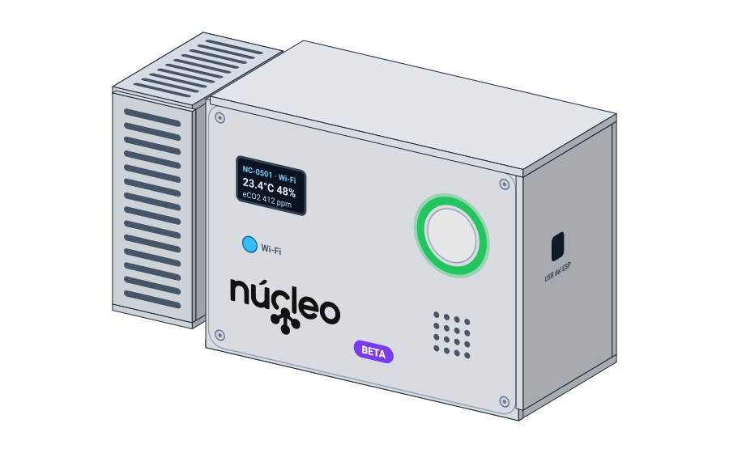

# Núcleo — Gestión y monitoreo del ambiente

Núcleo monitorea la temperatura, la humedad y la calidad del aire con nodos ESP32. Avisa en
vivo cuando una lectura sale de sus umbrales y genera reportes. Tiene web, app Android y
**Nico AI**, un agente que responde sobre cada dispositivo.

Hoy todo el sistema funciona y está publicado: backend, broker, canal en vivo, web y app
Android con notificaciones push. El firmware del ESP32 está escrito y probado en su lógica;
falta probarlo en la placa con los sensores, así que por ahora las lecturas vienen del simulador.

## Documentación

La documentación técnica completa está en **[Context/](Context/README.md)**, que es la fuente de
verdad del proyecto:

| Tema | Documento |
| --- | --- |
| Arquitectura y flujo de punta a punta | [arquitectura/arquitectura-general.md](Context/arquitectura/arquitectura-general.md) |
| Instalación y desarrollo local | [instalacion/guia-desarrollo-local.md](Context/instalacion/guia-desarrollo-local.md) |
| API compartida por web y móvil | [api/contrato-api.md](Context/api/contrato-api.md) |
| Base de datos | [base-de-datos/modelo-relacional.md](Context/base-de-datos/modelo-relacional.md) |
| Broker MQTT | [mqtt/broker-mosquitto.md](Context/mqtt/broker-mosquitto.md) |
| Firmware y conexiones del ESP32 | [iot/firmware-y-hardware.md](Context/iot/firmware-y-hardware.md) · [iot/conexiones.md](Context/iot/conexiones.md) |
| Nico AI | [agente/nico-ai.md](Context/agente/nico-ai.md) |
| Servidor de producción | [servidor/produccion.md](Context/servidor/produccion.md) |
| Seguridad | [seguridad/seguridad.md](Context/seguridad/seguridad.md) |
| Ramas y commits | [equipo/flujo-de-trabajo.md](Context/equipo/flujo-de-trabajo.md) |

En `Docs/` están el SRS, el modelo relacional, los documentos de planificación y análisis y el
[prototipo en 3D](Docs/nucleo3d/README.md).

## Qué funciona

- **Backend:** API con permisos por rol y por organización; recibe las lecturas por MQTT,
  crea alertas, avisa por correo y push y transmite en vivo; reportes con gráficas y PDF.
- **Nico AI:** responde con las lecturas y alertas de cada dispositivo y genera reportes cuando
  se le piden, en la web y en la app.
- **Web:** panel en vivo, dispositivos, histórico, alertas, reportes, Nico AI, umbrales,
  usuarios y empresa; además, administración de organizaciones para la plataforma.
- **App Android:** dispositivo en vivo, alertas, Nico AI y perfil, con notificaciones push.
- **IoT:** firmware de MicroPython con DHT22, CCS811, pantalla OLED, LED RGB, buzzer y cola sin
  conexión. Falta cargarlo en la placa y calibrar el CCS811.

## Direcciones

| Dirección | Para qué |
| --- | --- |
| **https://bynucleo.com** | Web, API de la app (`/api/v1`) y panel en vivo |
| **https://app.bynucleo.com** | Descarga de la app Android |

## Stack

```text
Stack
├── Backend          Python 3.12.15 · Django 5.2.18 · Django REST Framework 3.18.3 · Channels 4.3
├── Base de datos    PostgreSQL 17.11 · TimescaleDB 2.31.0 · Redis 7
├── Broker MQTT      Eclipse Mosquitto 2 con TLS
├── Web              React 19.3.1 · Vite 8.3.5 · React Router 7 · npm 11.16.0
├── App móvil        Expo 58.0.23 · React Native 0.88.1 · React Navigation 7 · npm 11.16.0
├── IoT              Python 3.12 · MicroPython 1.29.0 para ESP32 · Pymakr 2.22.5
└── Contenedores     Docker Engine 29.9.2 · Compose 5.6.1
```

Las versiones exactas están fijadas en los `requirements.txt` de backend e IoT y
en los `package-lock.json` de web y móvil.

## Carpetas

```text
Nucleo/
├── BackEnd/               Django, API compartida, pruebas y README
├── FrontEnd/              Web React + Vite y README
├── Mobile/                App Expo + React Native y README
├── IoT/                   MicroPython para ESP32, bibliotecas y README
├── Mosquitto/             Configuración del broker MQTT y scripts de certificados y dispositivos
├── Database/              Scripts .sql de práctica: Web-Mobile (PostgreSQL) e IoT (TimescaleDB),
│                          y crear-roles.sh (opcional)
├── deploy/                Instalación, despliegue, respaldos y APK del servidor
├── Context/               Documentación técnica completa para el equipo y la IA
├── Docs/                  SRS, modelo relacional, planificación y análisis
├── docker-compose.yml     PostgreSQL, TimescaleDB, Redis y Mosquitto en Docker
├── .env.example           Plantilla de configuración, sin secretos
├── .gitignore             Archivos que Git debe ignorar
└── README.md              Este documento
```

Cada parte tiene su README con sus comandos: [BackEnd](BackEnd/README.md),
[Web](FrontEnd/README.md), [Mobile](Mobile/README.md), [IoT](IoT/README.md) y
[Base de datos](Database/README.md).

## Inicio rápido

Necesitas Python 3.12, Node.js 22 o superior, Docker con Compose y Git. Primero crea los `.env` a
partir de sus `.env.example` (los pasos y qué va en cada uno están en la
[guía de desarrollo local](Context/instalacion/guia-desarrollo-local.md)). Después, desde la
carpeta principal:

- `docker compose up -d --wait postgres timescaledb redis` — "enciende las bases de datos y Redis."
- `python3.12 -m venv BackEnd/.venv && BackEnd/.venv/bin/pip install -r BackEnd/requirements-dev.txt` — "instala el backend."
- `cd BackEnd && .venv/bin/python manage.py migrate && .venv/bin/python manage.py migrate --database=iot` — "crea las tablas y la hypertable de lecturas."
- `cd BackEnd && .venv/bin/python manage.py sembrar_demo` — "carga organizaciones, usuarios, dispositivos y lecturas de demostración."
- `cd BackEnd && .venv/bin/python manage.py runserver 0.0.0.0:8000` — "abre la API en `http://127.0.0.1:8000`."
- `cd FrontEnd && npm ci && npm run dev` — "abre la web en `http://localhost:5173`."

El broker, el simulador de dispositivos, la app móvil, el ESP32 y las comprobaciones están en la
misma guía.

## Prototipo final esperado (beta)

Propuesta de cómo se vería Núcleo ya como producto, en una carcasa impresa en 3D (versión beta,
medidas aproximadas).



Las vistas exteriores e interiores, el esqueleto vacío, el cableado completo, las piezas una por
una y los planos con medidas en centímetros están en [Docs/nucleo3d](Docs/nucleo3d/README.md).
