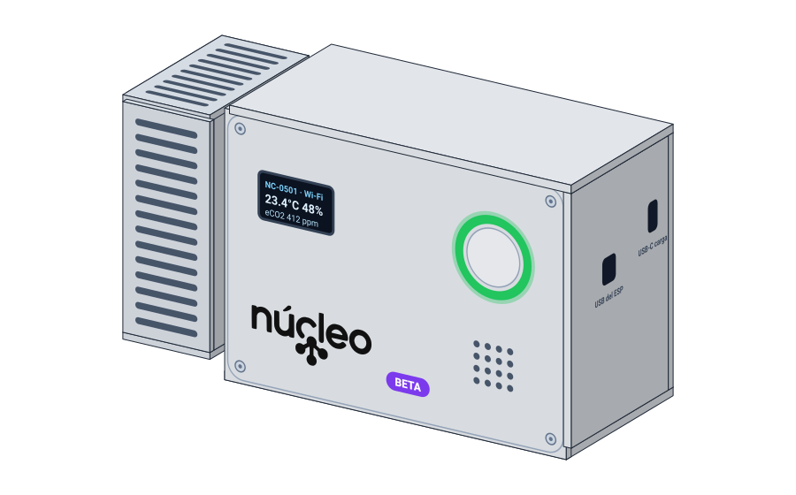
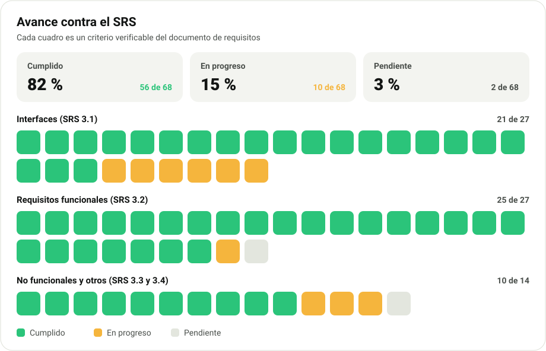
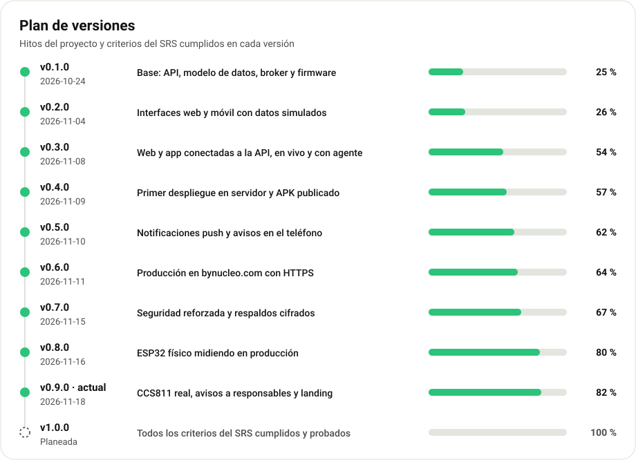

# Núcleo — Gestión y monitoreo del ambiente

Núcleo monitorea la temperatura, la humedad y la calidad del aire con nodos ESP32. Avisa en
vivo cuando una lectura sale de sus umbrales y genera reportes. Tiene web, app Android y
**Nico AI**, un agente que responde sobre cada dispositivo. Dos consolas aparte, solo para el
superusuario de la plataforma, administran a Nico AI y la seguridad, los accesos y los equipos.
Una landing pública presenta el producto y sus planes.

## Stack tecnológico y ramificación del proyecto

```text
Stack
├── Backend          Python 3.12.15 · Django 5.2.18 · Django REST Framework 3.18.3 · Channels 4.3
├── Base de datos    PostgreSQL 17.11 · TimescaleDB 2.31.0 · Redis 7
├── Broker MQTT      Eclipse Mosquitto 2 con TLS
├── Web              React 19.3.1 · Vite 8.3.8 · React Router 7 · npm 11.16.0
├── App móvil        Expo 58.0.23 · React Native 0.88.1 · React Navigation 7 · npm 11.16.0
├── IoT              Python 3.12 · MicroPython 1.29.0 para ESP32 · Pymakr 2.22.5
└── Contenedores     Docker Engine 29.9.2 · Compose 5.6.1
```

Las versiones exactas están fijadas en los `requirements.txt` de backend e IoT y
en los `package-lock.json` de web y móvil.

```text
Nucleo/
├── BackEnd/               Django, API compartida, pruebas y README
├── FrontEnd/              Web React + Vite y README
├── Mobile/                App Expo + React Native y README
├── IoT/                   MicroPython para ESP32, bibliotecas y README
├── Landing/               Página pública info.bynucleo.com (estática, sin build) y README
├── Mosquitto/             Configuración del broker MQTT y scripts de certificados y dispositivos
├── Database/              Scripts .sql de práctica: Web-Mobile (PostgreSQL) e IoT (TimescaleDB),
│                          y crear-roles.sh (opcional)
├── deploy/                Instalación, despliegue, respaldos y APK del servidor
├── Context/               Documentación técnica completa para el equipo y la IA
├── Docs/                  SRS, modelo relacional, planificación y análisis
├── .github/workflows/     Vigía externo cada 15 min y revisiones de seguridad
├── docker-compose.yml     PostgreSQL, TimescaleDB, Redis y Mosquitto en Docker
├── .env.example           Plantilla de configuración, sin secretos
├── .gitignore             Archivos que Git debe ignorar
├── CHANGELOG.md           Plan de versiones e historial de cambios
└── README.md              Este documento
```

Cada parte tiene su README con sus comandos: [BackEnd](BackEnd/README.md),
[Web](FrontEnd/README.md), [Mobile](Mobile/README.md), [IoT](IoT/README.md),
[Landing](Landing/README.md), [Servidor](deploy/README.md) y [Base de datos](Database/README.md). La documentación técnica completa está en
**[Context/](Context/README.md)**, la fuente de verdad del proyecto:

| Tema | Documento |
| --- | --- |
| Arquitectura y flujo de punta a punta | [arquitectura/arquitectura-general.md](Context/arquitectura/arquitectura-general.md) |
| Instalación y desarrollo local | [instalacion/guia-desarrollo-local.md](Context/instalacion/guia-desarrollo-local.md) |
| API compartida por web y móvil | [api/contrato-api.md](Context/api/contrato-api.md) |
| Base de datos | [base-de-datos/modelo-relacional.md](Context/base-de-datos/modelo-relacional.md) |
| Broker MQTT | [mqtt/broker-mosquitto.md](Context/mqtt/broker-mosquitto.md) |
| Firmware y conexiones del ESP32 | [iot/firmware-y-hardware.md](Context/iot/firmware-y-hardware.md) · [iot/conexiones.md](Context/iot/conexiones.md) |
| Nico AI | [agente/nico-ai.md](Context/agente/nico-ai.md) |
| Servidor de producción | [servidor/produccion.md](Context/servidor/produccion.md) |
| Seguridad | [seguridad/seguridad.md](Context/seguridad/seguridad.md) |
| Ramas y commits | [equipo/flujo-de-trabajo.md](Context/equipo/flujo-de-trabajo.md) |

En `Docs/` están el SRS, el modelo relacional, los documentos de planificación y análisis y el
[prototipo en 3D](Docs/nucleo3d/README.md). El trabajo se hace en la rama `dev`; `main` es lo
que corre en producción.

## Inicio rápido

Necesitas Python 3.12, Node.js 22 o superior, Docker con Compose y Git. Primero crea los `.env` a
partir de sus `.env.example` (los pasos y qué va en cada uno están en la
[guía de desarrollo local](Context/instalacion/guia-desarrollo-local.md)). Después, desde la
carpeta principal:

- `docker compose up -d --wait postgres timescaledb redis` — "enciende las bases de datos y Redis."
- `python3.12 -m venv BackEnd/.venv && BackEnd/.venv/bin/pip install -r BackEnd/requirements-dev.txt` — "instala el backend."
- `cd BackEnd && .venv/bin/python manage.py migrate && .venv/bin/python manage.py migrate --database=iot` — "crea las tablas y la hypertable de lecturas."
- `cd BackEnd && .venv/bin/python manage.py sembrar_demo` — "carga organizaciones, usuarios, dispositivos y lecturas de demostración."
- `cd BackEnd && .venv/bin/python manage.py runserver 0.0.0.0:8000` — "abre la API en `http://127.0.0.1:8000`."
- `cd FrontEnd && npm ci && npm run dev` — "abre la web en `http://localhost:5173`."

El broker, el simulador de dispositivos, la app móvil, el ESP32 y las comprobaciones están en la
misma guía.

## Qué funciona actualmente

- **Backend:** API con permisos por rol y por organización; recibe las lecturas por MQTT,
  crea alertas, avisa por correo y push a los supervisores del área, los administradores de la
  organización y el operador asignado, y transmite en vivo; reportes con gráficas y PDF.
- **Web:** panel en vivo, dispositivos, histórico, alertas, reportes, Nico AI, umbrales,
  usuarios y empresa; además, administración de organizaciones para la plataforma.
- **App Android:** dispositivo en vivo, alertas, Nico AI y perfil, con notificaciones push.
- **Nico AI:** responde con las lecturas y alertas de cada dispositivo y genera reportes cuando
  se le piden, en la web y en la app. Su consola tiene panel, banco de respuestas, registro de
  preguntas (con «Enseñar»), herramientas y notificaciones.
- **Consola de administración:** panel, alertas de seguridad con notificaciones, auditoría,
  políticas, usuarios, sesiones abiertas por dispositivo, dispositivos, integraciones y carga del
  firmware al ESP32 por USB desde el navegador.
- **IoT:** firmware 1.1.3 de MicroPython con DHT22, CCS811, pantalla OLED, LED RGB, buzzer, cola
  sin conexión, microSD y actualización remota (OTA). Un ESP32-S3 físico (`NC-0501`) ya publica
  temperatura, humedad y calidad del aire reales y es la llave de Nico AI; los demás equipos de la
  demostración vienen del simulador. Falta probar la batería y la microSD en la placa.
- **Landing:** presentación pública narrada por Nico, con modo claro y oscuro, capturas reales,
  dispositivo interactivo, planes y preguntas frecuentes.

## En dónde funciona

### Dominios y subdominios

| Dirección | Para qué |
| --- | --- |
| **https://bynucleo.com** | Página principal |
| **https://app.bynucleo.com** | Descarga de la app Android |
| **https://info.bynucleo.com** | Landing pública: producto, planes y preguntas |
| **https://nicoai.bynucleo.com** | Consola de Nico AI (solo superusuario) |
| **https://admin.bynucleo.com** | Consola de administración (solo superusuario) |
| `dispositivos.bynucleo.com` | Solo para los ESP32: MQTT dentro de WebSocket y llave de Nico AI |

### Host

Un solo servidor propio con Debian 13 publica todo por un túnel de Cloudflare, sin puertos
abiertos. Caddy sirve la web y reparte las peticiones; Daphne atiende la API y el canal en
vivo; PostgreSQL, TimescaleDB, Redis y Mosquitto corren en Docker; servicios de systemd
escuchan el broker, marcan los equipos sin conexión y generan los reportes programados. Hay dos
respaldos cifrados al día, una prueba mensual de restauración y un vigía externo en GitHub Actions
que revisa los sitios cada 15 minutos. Detalles en [servidor/produccion.md](Context/servidor/produccion.md)
y [deploy/README.md](deploy/README.md).

## Dispositivo ESP32

Cada nodo es un ESP32-S3 con MicroPython 1.29. Mide temperatura y humedad (DHT22) y
calidad del aire (CCS811), las muestra en una pantalla OLED y avisa con un LED RGB y un buzzer
cuando algo sale de rango. Publica sus lecturas por MQTT con TLS (por WebSocket a través de
Cloudflare), guarda en cola lo que no pudo enviar sin conexión, recibe su configuración y
umbrales del servidor y se actualiza solo (OTA). También firma las peticiones de Nico AI de su
dispositivo: sin el ESP conectado, ese agente no usa la IA. Conexiones y firmware en
[iot/firmware-y-hardware.md](Context/iot/firmware-y-hardware.md) e
[iot/conexiones.md](Context/iot/conexiones.md).

## Prototipo final esperado (beta)

Propuesta de cómo se vería Núcleo ya como producto, en una carcasa impresa en 3D (versión beta,
medidas aproximadas).



Las vistas exteriores e interiores, el esqueleto vacío, el cableado completo, las piezas una por
una y los planos con medidas en centímetros están en [Docs/nucleo3d](Docs/nucleo3d/README.md).

<!-- avance:inicio (generado con Docs/progreso/generar.py) -->
## Avance contra el SRS

Núcleo cumple **56 de 68 criterios (82 %)** de la [especificación de requisitos](Docs/PDFs/SRS.pdf); 10 están en progreso y 2 pendientes.

<picture>
  <source media="(prefers-color-scheme: dark)" srcset="Docs/progreso/srs-oscuro.svg">
  
</picture>

| Área del SRS | Cumplido | En progreso | Pendiente |
| --- | ---: | ---: | ---: |
| Interfaces (SRS 3.1) | 21 | 6 | 0 |
| Requisitos funcionales (SRS 3.2) | 25 | 1 | 1 |
| No funcionales y otros (SRS 3.3 y 3.4) | 10 | 3 | 1 |
| **Total** | **56** | **10** | **2** |

**Lo que falta para cumplir el SRS:**

- En progreso · Modo de bajo consumo en la app (SRS 3.1.1): Solo existe «Reducir animaciones».
- En progreso · LED RGB de nivel en la unidad física (SRS 3.1.1): Programado; falta confirmarlo en la placa.
- En progreso · LED de estado Wi-Fi (SRS 3.1.1): Programado; falta confirmarlo en la placa.
- En progreso · Zumbador de alertas (SRS 3.1.1): Programado; falta confirmarlo en la placa.
- En progreso · Batería de litio con módulo de carga (SRS 3.1.2): Programada; falta conectarla y probarla.
- En progreso · Carcasa impresa en 3D (SRS 3.1.2): Diseño beta; falta la pieza final.
- Pendiente · Acondicionamiento inicial de 48 horas (SRS 3.2.1): Falta registrarlo por sensor.
- En progreso · Respuesta con LED RGB y alarma sonora (SRS 3.2.2): Programada; falta confirmarla en la placa.
- Pendiente · 100 horas continuas sin fallas (SRS 3.3.3): Falta la prueba de duración.
- En progreso · Disponibilidad del 99 % (SRS 3.3.4): Hay vigía externo; falta medirla en un periodo.
- En progreso · Chrome, Edge, Firefox y Safari (SRS 3.3.6): Falta la prueba formal en los cuatro navegadores.
- En progreso · Hardware completamente portátil (SRS 3.3.6): Depende de la batería.

<details>
<summary>Ver los criterios cumplidos</summary>

| SRS | Criterio | Versión |
| --- | --- | --- |
| 3.1.1 | Web en modo claro y oscuro | 0.2.0 |
| 3.1.1 | Panel web con datos en tiempo real | 0.3.0 |
| 3.1.1 | Gráficas con filtros de fecha, ubicación y sensor | 0.3.0 |
| 3.1.1 | Panel de alertas por severidad y estado | 0.3.0 |
| 3.1.1 | Formularios de parámetros y umbrales | 0.3.0 |
| 3.1.1 | Reportes e históricos con IA | 0.3.0 |
| 3.1.1 | Agente de IA en la web | 0.3.0 |
| 3.1.1 | App en modo claro y oscuro | 0.8.0 |
| 3.1.1 | App con lecturas actuales | 0.3.0 |
| 3.1.1 | App con dispositivos del área para el supervisor | 0.5.0 |
| 3.1.1 | App con alertas visuales, sonoras y push | 0.5.0 |
| 3.1.1 | App con tendencias de 24 horas | 0.3.0 |
| 3.1.1 | App adaptable a distintas pantallas | 0.3.0 |
| 3.1.1 | Pantalla OLED en la unidad física | 0.8.0 |
| 3.1.2 | Sensores DHT22 y CCS811 en el ESP32 | 0.9.0 |
| 3.1.3 | PostgreSQL y TimescaleDB separadas | 0.1.0 |
| 3.1.4 | MQTT con TLS y sin acceso anónimo | 0.1.0 |
| 3.1.4 | Configuración retenida para el dispositivo | 0.1.0 |
| 3.1.4 | Consulta de lecturas cada 30 segundos | 0.3.0 |
| 3.1.4 | Canal en vivo autenticado con token | 0.3.0 |
| 3.1.4 | App en segundo plano recibe alertas por push | 0.5.0 |
| 3.2.1 | Lectura automática con intervalo configurable | 0.8.0 |
| 3.2.1 | Calentamiento del CCS811 de 20 minutos | 0.8.0 |
| 3.2.2 | Clasificación normal, advertencia y peligro | 0.1.0 |
| 3.2.2 | Registro de nivel, estado, responsable y hora | 0.1.0 |
| 3.2.2 | Sin alertas repetidas y con escalamiento | 0.1.0 |
| 3.2.2 | Correo a los responsables | 0.3.0 |
| 3.2.2 | Push a los responsables | 0.5.0 |
| 3.2.3 | Datos en web, app y dispositivo | 0.8.0 |
| 3.2.4 | Cinco roles con funciones definidas | 0.1.0 |
| 3.2.4 | Aislamiento de datos por organización | 0.1.0 |
| 3.2.4 | Administración de organizaciones | 0.3.0 |
| 3.2.4 | Alcance por área y dispositivo asignado | 0.1.0 |
| 3.2.5 | Validación del orden de los umbrales | 0.1.0 |
| 3.2.5 | Rangos físicos y descarte de lecturas inválidas | 0.1.0 |
| 3.2.6 | Flujo completo del sensor a las aplicaciones | 0.8.0 |
| 3.2.7 | Dispositivo sigue alertando sin conexión | 0.8.0 |
| 3.2.7 | Estado «Sin conexión» tras 3 intervalos | 0.1.0 |
| 3.2.8 | Salidas en PDF y correo programado | 0.3.0 |
| 3.2.9 | Respuesta automática ante condiciones inseguras | 0.3.0 |
| 3.2.10 | Almacenamiento completo de cada medición | 0.1.0 |
| 3.2.11 | Histórico y gráficas de tendencia | 0.3.0 |
| 3.2.12 | Reportes con cifras del backend y texto de IA | 0.3.0 |
| 3.2.12 | Reportes programados por frecuencia y área | 0.3.0 |
| 3.2.12 | Respuesta 503 sin servicio de IA | 0.1.0 |
| 3.2.12 | Agente de solo lectura en lenguaje natural | 0.3.0 |
| 3.3.1 | Varios dispositivos y organizaciones sin cambiar código | 0.3.0 |
| 3.3.1 | Tiempos e índices para comprobar los 2 minutos | 0.1.0 |
| 3.3.2 | Comunicación por HTTPS y TLS | 0.6.0 |
| 3.3.2 | Bases privadas y contraseñas cifradas | 0.4.0 |
| 3.3.2 | Usuario propio para cada base de datos | 0.1.0 |
| 3.3.2 | Límite de intentos y caducidad del token | 0.1.0 |
| 3.3.3 | Restricciones de integridad en la base de datos | 0.1.0 |
| 3.3.5 | Estado y calibración de cada sensor | 0.1.0 |
| 3.3.6 | App disponible para Android | 0.4.0 |
| 3.4 | Reportes y respuestas sin capacitación previa | 0.3.0 |

</details>

## Plan de versiones

La versión actual del proyecto es **0.9.0**. Cada versión marca un avance real contra el SRS y el detalle está en el **[CHANGELOG](CHANGELOG.md)**.

<picture>
  <source media="(prefers-color-scheme: dark)" srcset="Docs/progreso/versiones-oscuro.svg">
  
</picture>

<!-- avance:fin -->
